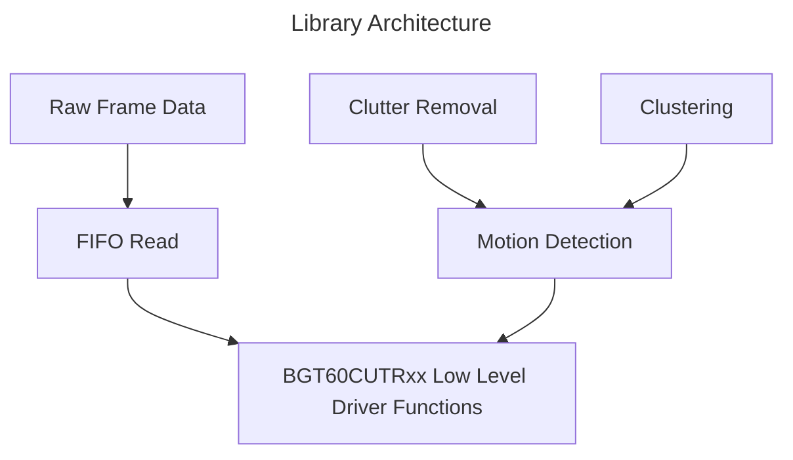
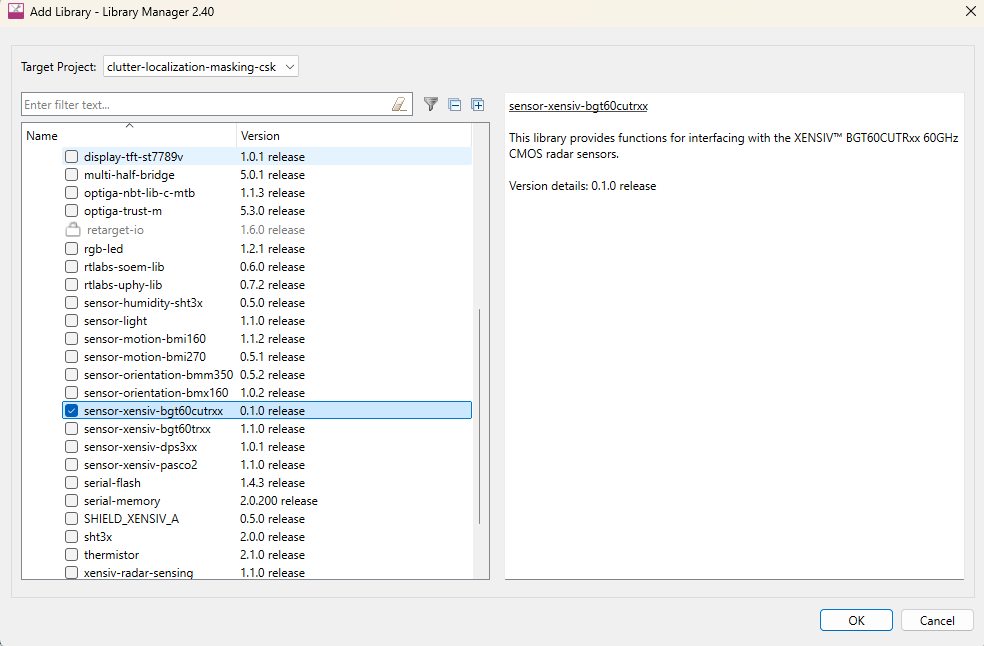
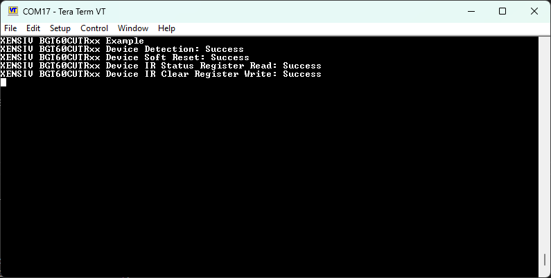
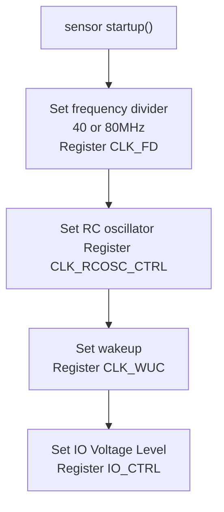
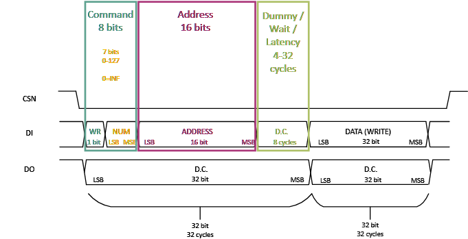
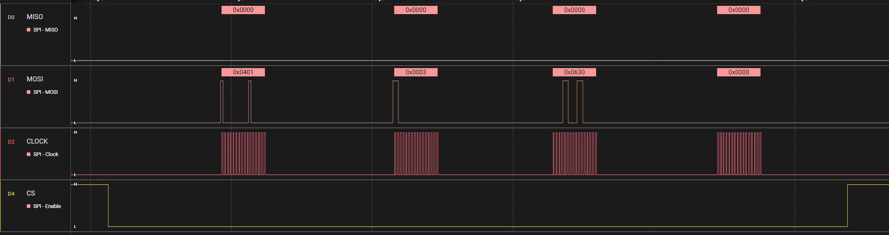
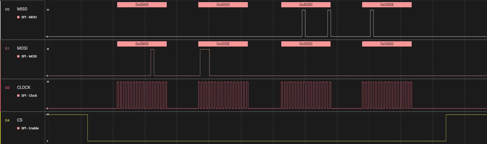

# XENSIV&trade; BGT60CUTRxx radar sensor library

The XENSIV&trade; BGT60CUTRxx radar sensor library offers driver functions to interface with the XENSIV™ BGT60CUTRxx CMOS 60 GHz radar sensor. It also includes data processing modules for on-chip motion detection blocks. It is compatible with the XENSIV™ CMOS 60 GHz radar sensors: BGT60CUTR13AIP

This library can be set up to use the ModusToolbox&trade; HAL interface or user-provided communication functions. For more information about the XENSIV&trade; radar sensors, visit Infineon's [60 GHz CMOS radar sensors for IoT](https://www.infineon.com/products/sensor/radar-sensors/radar-sensors-for-iot/60ghz-cmos-radar) webpage.

For further information, please visit the website <https://www.infineon.com/part/BGT60CUTR13AIP>.

How to port the driver to other platforms is provided in [porting guide](docs/porting-guide/SW-Porting-Guide-Arduino.md).

<!-- \cond NOTDOXYGEN -->

## Table of contents

- [XENSIV™ BGT60CUTRxx radar sensor library](#xensiv-bgt60cutrxx-radar-sensor-library)
  - [Table of contents](#table-of-contents)
  - [Features](#features)
    - [Figure 1. Library architecture](#figure-1-library-architecture)
  - [Quick start](#quick-start)
  - [BGT60CUTRxx driver functions](#bgt60cutrxx-driver-functions)
    - [Error codes](#error-codes)
    - [Power management API](#power-management-api)
    - [Using the library with another platform](#using-the-library-with-another-platform)
    - [Driver startup sequence](#driver-startup-sequence)
      - [Table 1. Default radar device startup register configuration](#table-1-default-radar-device-startup-register-configuration)
    - [SPI communication protocol](#spi-communication-protocol)
      - [SPI configuration](#spi-configuration)
      - [SPI read/write protocol](#spi-readwrite-protocol)
      - [Figure 4. SPI write protocol timing diagram](#figure-4-spi-write-protocol-timing-diagram)
      - [Table 2. SPI write command packet structure](#table-2-spi-write-command-packet-structure)
      - [Figure 5. Physical transmission for register write operation](#figure-5-physical-transmission-for-register-write-operation)
      - [Figure 6. Physical transmission diagram for SPI register read operation](#figure-6-physical-transmission-diagram-for-spi-register-read-operation)
      - [Table 3. SPI read command packet structure](#table-3-spi-read-command-packet-structure)
      - [Figure 7. Physical transmission for SPI register read packet](#figure-7-physical-transmission-for-spi-register-read-packet)
      - [Figure 8. Timing diagram for continuous SPI memory read operation](#figure-8-timing-diagram-for-continuous-spi-memory-read-operation)
  - [BGT60CUTRxx processing functions](#bgt60cutrxx-processing-functions)
    - [Motion detection](#motion-detection)
      - [Motion detection output](#motion-detection-output)
    - [Clustering](#clustering)
      - [Clustering output](#clustering-output)
      - [Clustering configuration](#clustering-configuration)
    - [Convergence](#convergence)
      - [Convergence output](#convergence-output)
      - [Convergence configuration](#convergence-configuration)
    - [Clutter localization and masking](#clutter-localization-and-masking)
      - [Clutter localization configuration](#clutter-localization-configuration)
  - [BGT60CUTRxx frame acquisition](#bgt60cutrxx-frame-acquisition)
  - [Linux kernel driver](#linux-kernel-driver)
  - [Calibration matrix update](#calibration-matrix-update)
  - [More information](#more-information)

<!-- \endcond -->

## Features

- On-chip data processing for motion detection
- Range and angle estimation of up to 8 targets
- Clutter localization and masking of dynamic targets, based on RD motion detection events
- Clustering of static targets, based on ULP motion detection events
- Convergence module for temporal fusion of RD and ULP results into a flicker-free output
- Power down / deep sleep mode support with configurable post-calibration power state
- Raw frame data acquisition
- SPI communication
- Arduino platform support (see [porting guide](docs/porting-guide/SW-Porting-Guide-Arduino.md))
- Linux kernel driver for Raspberry Pi and similar SBCs (not part of the release, but available on request)

[View this README on GitHub.](https://github.com/Infineon/mtb-example-psoc6-cmos-radar-motion-detection)

### Figure 1. Library architecture



## Quick start

The initialization of the XENSIV&trade; BGT60CUTRxx radar sensor requires a list of register values that can be generated using the Radar Configuration tool.

Code snippets for using the XENSIV&trade; BGT60CUTRxx Radar Sensor library are provided below:

- The *radar_fifo* folder contains the snippets for reading the raw radar data from the FIFO of the BGT60CUTRxx sensor

- The *motion_detection* folder contains the snippets for reading the motion detection information from the BGT60CUTRxx sensor

Follow the steps below to create a simple application that checks basic functionality and connectivity to the radar sensor. The application configures the sensor according to the predefined configuration, starts the frame generation, and reads frame data from the internal radar buffer.

1. Create an empty ModusToolbox&trade; application for your board, e.g., CYSBSYSKIT-DEV-01

2. Add this library, *sensor-xensiv-bgt60cutrxx*, to the application using **Library Manager**

   Figure 2. Library Manager

   

3. Add the *retarget-io* library using **Library Manager**

4. Define the following as required for your hardware/kit configuration:

   - `PIN_XENSIV_BGT60CUTRXX_SPI_SCLK`
   - `PIN_XENSIV_BGT60CUTRXX_SPI_MOSI`
   - `PIN_XENSIV_BGT60CUTRXX_SPI_MISO`
   - `PIN_XENSIV_BGT60CUTRXX_SPI_CSN`
   - `PIN_XENSIV_BGT60CUTRXX_IRQ`
   - `PIN_XENSIV_BGT60CUTRXX_RSTN`
   - `PIN_XENSIV_BGT60CUTRXX_LDO_EN`

    > **Note:**
    > 1. The pins in the code example below correspond to the ones used in the  [CYSBSYSKIT-DEV-01](https://github.com/Infineon/TARGET_CYSBSYSKIT-DEV-01) kit
    > 2. The LDO_EN pin is not directly connected to the sensor and may not be present in all boards

5. Place the following code in the *main.c* file

```cpp

#include "cyhal.h"
#include "cy_retarget_io.h"

#include "common.h"
#include "radar_motion_detection.h"
#include "resource_map.h"
#include "radar_config/indoor_motion_low_power.h"
#include "xensiv_bgt60cutrxx_mtb.h"
#include "xensiv_bgt60cutrxx_regs.h"

/*******************************************************************************
 * Macros
 ********************************************************************************/

/** Enables runtime measurement of data processing components */
//#define MEASURE_PROCESSING_TIME

/** baud rate for the UART communication
 * The baudrate must be high enough to transmit the data before the next interrupt occurs.
 */
#define UART_BAUDRATE 2000000

/** Default SPI speed for the XENSIV BGT60CUTRxx sensor, which is used during startup */
#define SPI_FREQUENCY               (18750000UL) // 18.75MHz

/** LED pins for radar shield feather adapter board*/
#define SHIELD_XENSIV_RADAR_LED_RED           CYBSP_GPIOA0
/** LED state definitions need to be inverted */
#define SHIELD_XENSIV_RADAR_LED_RED_ON        CYBSP_LED_STATE_OFF
/** LED state definitions need to be inverted */
#define SHIELD_XENSIV_RADAR_LED_RED_OFF       CYBSP_LED_STATE_ON

#define SHIELD_XENSIV_RADAR_LED_GREEN         CYBSP_GPIOA1
/** LED state definitions need to be inverted */
#define SHIELD_XENSIV_RADAR_LED_GREEN_ON     CYBSP_LED_STATE_OFF
/** LED state definitions need to be inverted */
#define SHIELD_XENSIV_RADAR_LED_GREEN_OFF    CYBSP_LED_STATE_ON

#define SHIELD_XENSIV_USER_SWITCH             CYBSP_GPIO6
#define SHIELD_XENSIV_DIR4_EN                 CYBSP_GPIOA2

/** Radar Sensor pins */
#define PIN_XENSIV_BGT60CUTRXX_OPEN_DRAIN     CYBSP_GPIO9
#define PIN_XENSIV_BGT60CUTRXX_PHASE_DETECT   CYBSP_GPIO12 // DIO5
#define PIN_XENSIV_BGT60CUTRXX_TARGET_DETECT  CYBSP_GPIO13

#define PIN_XENSIV_BGT60CUTRXX_IFI            CYBSP_GPIOA3
#define PIN_XENSIV_BGT60CUTRXX_IFQ            CYBSP_GPIOA4

#define PIN_XENSIV_BGT60CUTRXX_DIO2           PIN_XENSIV_BGT60CUTRXX_TARGET_DETECT
#define PIN_XENSIV_BGT60CUTRXX_DIO3           CYBSP_GPIO11


/** Radar sensor SPI pins */
#define PIN_XENSIV_BGT60CUTRXX_SPI_SCLK       CYBSP_SPI_CLK
#define PIN_XENSIV_BGT60CUTRXX_SPI_MOSI       CYBSP_SPI_MOSI
#define PIN_XENSIV_BGT60CUTRXX_SPI_MISO       CYBSP_SPI_MISO
#define PIN_XENSIV_BGT60CUTRXX_SPI_CSN        CYBSP_SPI_CS
#define PIN_XENSIV_BGT60CUTRXX_IRQ            CYBSP_GPIO10
#define PIN_XENSIV_BGT60CUTRXX_RSTN           CYBSP_GPIOA5

#define PIN_XENSIV_BGT60CUTRXX_LDO_EN         CYBSP_GPIO5

/*******************************************************************************
* Function Prototypes
*******************************************************************************/
static void xensiv_bgt60cutrxx_irq_handler(void* callback_arg, cyhal_gpio_event_t event);
static int32_t xensiv_bgt60cutrxx_board_init(void);
static int32_t initialize_board_leds(void);
static void timer_start(void);
static uint32_t timer_get_elapsed_us(void);
static void print_elapsed_time(uint32_t counter);

/*******************************************************************************
* Global Variables
*******************************************************************************/

/** Radar sensor object */
static xensiv_bgt60cutrxx_mtb_t sensor;

/** Motion detection object */
static motion_detection_t motion_detection;

/** Buffer to store the full range Doppler map */
#ifdef RADAR_MOTION_DETECTION_USE_RD_BUFFER
static uint32_t rd_data_buffer[BGT60CUTR13_RD_DATABUFFER_MAX_SIZE];
#else
static uint32_t rd_data_buffer[0];
#endif

/** Helper variable used by IRQ handler to indicate data events to main loop */
static volatile bool radar_event_irq = false;

/** Helper variables used for runtime measurement */
#ifdef MEASURE_PROCESSING_TIME
static cyhal_timer_t timer_obj;
#endif
static uint32_t motion_detection_elapsed_us = 0;

/** Platform interface configuration */
static xensiv_bgt60cutrxx_mtb_iface_config_t mcu_iface_config =
{
    .selpin       = PIN_XENSIV_BGT60CUTRXX_SPI_CSN,
    .rstpin       = PIN_XENSIV_BGT60CUTRXX_RSTN,
    .irqpin       = PIN_XENSIV_BGT60CUTRXX_IRQ,
    .irq_priority = CYHAL_ISR_PRIORITY_DEFAULT,
    .spi_mosi     = CYBSP_SPI_MOSI,
    .spi_miso     = CYBSP_SPI_MISO,
    .spi_clk      = CYBSP_SPI_CLK,
    .spi_speed_hz = SPI_FREQUENCY,
};

/*******************************************************************************
* Function definitions
*******************************************************************************/

/**
 * @brief Interrupt handler for the XENSIV BGT60CUTRxx radar sensor.
 *
 * This function is called when a radar interrupt occurs. It sets the radar_event_irq
 * flag to signal the main loop that radar data is ready for processing.
 *
 * @param[in] callback_arg User-defined callback argument (unused).
 * @param[in] event GPIO event that triggered the interrupt.
 */
static void xensiv_bgt60cutrxx_irq_handler(void* callback_arg, cyhal_gpio_event_t event)
{
    (void)callback_arg;
    (void)event;

    // flag to indicate radar event
    radar_event_irq = true;
}


/** Helper function to initialize board-specific settings */
static int32_t xensiv_bgt60cutrxx_board_init(void)
{
    cy_rslt_t result = CY_RSLT_SUCCESS;

    /* Enable LDO */
    result |= cyhal_gpio_init(PIN_XENSIV_BGT60CUTRXX_LDO_EN, CYHAL_GPIO_DIR_OUTPUT, CYHAL_GPIO_DRIVE_STRONG, 1);

    /* Set specific pins to disable BGT60CUTRxx bootloader */
    result |= cyhal_gpio_init(PIN_XENSIV_BGT60CUTRXX_DIO2, CYHAL_GPIO_DIR_OUTPUT, CYHAL_GPIO_DRIVE_STRONG, 1);
    result |= cyhal_gpio_init(PIN_XENSIV_BGT60CUTRXX_DIO3, CYHAL_GPIO_DIR_OUTPUT, CYHAL_GPIO_DRIVE_STRONG, 1);

    /* Set level shifter direction */
    result |= cyhal_gpio_init(SHIELD_XENSIV_DIR4_EN, CYHAL_GPIO_DIR_OUTPUT, CYHAL_GPIO_DRIVE_STRONG, 1);

    if (result != CY_RSLT_SUCCESS)
    {
        /* Board specific settings failed. Stop program execution */
        CY_ASSERT(0);
    }

    return XENSIV_BGT60CUTRXX_STATUS_OK;
}


/** Helper function to initialize board LEDs */
static int32_t initialize_board_leds(void)
{
    cy_rslt_t result = CY_RSLT_SUCCESS;

    result |= cyhal_gpio_init(CYBSP_USER_LED, CYHAL_GPIO_DIR_OUTPUT,
                              CYHAL_GPIO_DRIVE_STRONG, CYBSP_LED_STATE_OFF);
    result |= cyhal_gpio_init(SHIELD_XENSIV_RADAR_LED_RED, CYHAL_GPIO_DIR_OUTPUT,
                              CYHAL_GPIO_DRIVE_STRONG, SHIELD_XENSIV_RADAR_LED_RED_OFF);
    result |= cyhal_gpio_init(SHIELD_XENSIV_RADAR_LED_GREEN, CYHAL_GPIO_DIR_OUTPUT,
                              CYHAL_GPIO_DRIVE_STRONG, SHIELD_XENSIV_RADAR_LED_GREEN_OFF);

    if (result != CY_RSLT_SUCCESS)
    {
        /* LED GPIO initialization failed. Stop program execution */
        CY_ASSERT(0);
    }

    return XENSIV_BGT60CUTRXX_STATUS_OK;
}


/** Helper function used for runtime measurement */
static void timer_start(void)
{
    #ifdef MEASURE_PROCESSING_TIME
    const cyhal_timer_cfg_t timer_cfg =
    {
        .compare_value = 0,                         // Timer compare value, not used
        .period        = CYHAL_TIMER_DEFAULT_FREQ,  // Timer period 1 second
        .direction     = CYHAL_TIMER_DIR_UP,        // Timer counts up
        .is_compare    = false,                     // Don't use compare mode
        .is_continuous = false,                     // Do not run timer indefinitely
        .value         = 0                          // Initial value of counter
    };

    cyhal_timer_free(&timer_obj);
    cyhal_timer_init(&timer_obj, NC, NULL);
    cyhal_timer_configure(&timer_obj, &timer_cfg);
    cyhal_timer_set_frequency(&timer_obj, CYHAL_TIMER_DEFAULT_FREQ);
    cyhal_timer_start(&timer_obj);
    #endif // ifdef MEASURE_PROCESSING_TIME
}


/** Helper function used for runtime measurement */
static uint32_t timer_get_elapsed_us(void)
{
    #ifdef MEASURE_PROCESSING_TIME
    cyhal_timer_stop(&timer_obj);
    return cyhal_timer_read(&timer_obj);
    #else
    return 0;
    #endif
}


/** Helper function used for runtime measurement */
static void print_elapsed_time(uint32_t counter)
{
    (void)counter;
    #ifdef MEASURE_PROCESSING_TIME
    print_algo_processing_times(counter, motion_detection_elapsed_us, 0, 0, Cy_SysClk_ClkHfGetFrequency(0UL));
    #endif
}


/**
 * @brief Main application entry point for radar motion detection code example.
 *
 * This function performs the following operations:
 * - Initializes the device, board peripherals, and UART for debug output
 * - Configures GPIO pins and SPI interface for the XENSIV BGT60CUTRxx radar sensor
 * - Sets up the radar sensor with interrupt-driven data acquisition
 * - Initializes motion detection with range-doppler and ultra-low-power sequences
 * - Enters an infinite loop processing radar interrupts, detecting motion

 *
 * @return int This function never returns under normal operation due to infinite loop.
 */
int main(void)
{
    cy_rslt_t result;

    #if defined (CY_DEVICE_SECURE)
    cyhal_wdt_t wdt_obj;

    /* Clear watchdog timer so that it doesn't trigger a reset */
    result = cyhal_wdt_init(&wdt_obj, cyhal_wdt_get_max_timeout_ms());
    CY_ASSERT(CY_RSLT_SUCCESS == result);
    cyhal_wdt_free(&wdt_obj);
    #endif /* #if defined (CY_DEVICE_SECURE) */

    // Initialize MCU and board peripherals
    result = cybsp_init();
    result |= initialize_board_leds();
    if (result != CY_RSLT_SUCCESS)
    {
        // MCU and board init failed. Stop program execution
        CY_ASSERT(0);
    }

    // Enable global interrupts
    __enable_irq();

    // Initialize UART port used for logging
    result = cy_retarget_io_init_fc(CYBSP_DEBUG_UART_TX, CYBSP_DEBUG_UART_RX, NC, NC, UART_BAUDRATE);
    if (result != CY_RSLT_SUCCESS)
    {
        // retarget-io init failed. Stop program execution
        CY_ASSERT(0);
    }

    // wait until UART is ready
    cyhal_system_delay_ms(5000);

    // Transmit ANSI ESC sequence to clear terminal screen
    printf("\x1b[2J\x1b[;H");

    printf("****************** "
           "RADAR: Motion Detection Example "
           "****************** \r\n\n");

    printf("For more projects, "
           "visit our code examples repositories:\r\n\n");

    printf("https://github.com/Infineon/"
           "Code-Examples-for-ModusToolbox-Software\r\n\n");


    result = xensiv_bgt60cutrxx_board_init();
    result |= xensiv_bgt60cutrxx_platform_open(&sensor.iface, &mcu_iface_config);
    if (XENSIV_BGT60CUTRXX_STATUS_OK != result)
    {
        printf("Error initializing platform interfaces\n");
        CY_ASSERT(0);
    }

    // Radar sensor initialization
    result = xensiv_bgt60cutrxx_platform_init(&sensor, &mcu_iface_config, register_list, ARRAY_SIZE(register_list), ACTIVE_MODE, false);
    if (XENSIV_BGT60CUTRXX_STATUS_OK != result)
    {
        printf("Error initializing radar sensor\n");
        CY_ASSERT(0);
    }
    printf("Radar sensor is initialized\n\r");

    result = xensiv_bgt60cutrxx_platform_irq_init(&sensor, &mcu_iface_config, xensiv_bgt60cutrxx_irq_handler, NULL);
    if (XENSIV_BGT60CUTRXX_STATUS_OK != result)
    {
        printf("Error initializing radar IRQ handler\n");
        CY_ASSERT(0);
    }

    #if MD_RD_ENABLED
    // Radar Motion Detection initialization
    const float rd_velocity_grid[] = RD_VELOCITY_GRID_MPS;
    const sequence_settings_t rd_sequence_settings =
    {
        .enabled            = true,
        .velocity_grid_mps  = rd_velocity_grid,
        .range_resolution_m = RD_RANGE_RESOLUTION_M
    };
    #else
    const sequence_settings_t rd_sequence_settings = {};
    #endif

    #if MD_ULP_ENABLED
    const float ulp_velocity_grid[] = ULP_VELOCITY_GRID_MPS;
    const sequence_settings_t ulp_sequence_settings =
    {
        .enabled            = true,
        .velocity_grid_mps  = ulp_velocity_grid,
        .range_resolution_m = ULP_RANGE_RESOLUTION_M
    };
    #else
    const sequence_settings_t ulp_sequence_settings = {};
    #endif

    result = radar_motion_detection_init(&motion_detection,
                                         &sensor.dev,
                                         rd_data_buffer,
                                         &rd_sequence_settings,
                                         &ulp_sequence_settings
                                         );
    if (XENSIV_BGT60CUTRXX_STATUS_OK != result)
    {
        printf("Radar Motion Detection initialization failed\n");
    }
    printf("Radar Motion Detection is initialized\n\r");

    radar_event_irq = false;
    uint32_t irq_status = 0;
    xensiv_bgt60cutrxx_get_irq_status(motion_detection.radar_sensor, &irq_status);
    xensiv_bgt60cutrxx_set_irq_clear(motion_detection.radar_sensor, BGT60CUTR13B_IR_CLEAR_FOR_STARTUP_MSK);


    for (;;)
    {
        if (radar_event_irq)
        {
            radar_event_irq = false;
            static uint32_t counter = 0;

            // Process radar motion detection
            timer_start();
            int32_t result = radar_motion_detection_process(&motion_detection);
            motion_detection_elapsed_us = timer_get_elapsed_us();
            if (result < 0)
            {
                printf("Motion Detection process error: %ld\n", result);
            }
            print_detections(&motion_detection, counter);
            print_elapsed_time(counter);
            counter++;
        }
    }
}

```

1. Connect the board to your PC using the provided USB cable through the KitProg3 USB connector

2. Open a terminal program and select the KitProg3 COM port. Set the serial port parameters to 8N1 and 115200 baud

3. Build the application and program the kit. After programming, the application starts automatically and prints the following output on serial terminal

    Figure 3. Terminal Output

    

## BGT60CUTRxx driver functions

The driver part of the library is divided into two modules. The radar-specific module contains the functions to reset, initialize, detect, configure, and read the data from radar. These functions are part of the following code files:

- *xensiv_bgt60cutrxx.c*
- *xensiv_bgt60cutrxx.h*
- *xensiv_bgt60cutrxx_regs.h*
  
The second part is platform-specific implementation, which includes SPI communications and GPIO handling. The PSOC&trade; 6 implementation is provided with this library in following files:

- *xensiv_bgt60cutrxx_mtb.c*
- *xensiv_bgt60cutrxx_mtb.h*

### Error codes

All driver functions return `int32_t`. A return value of `0` (`XENSIV_BGT60CUTRXX_STATUS_OK`) indicates success. All error codes are **negative integers**:

| Constant | Value | Description |
|----------|-------|-------------|
| `XENSIV_BGT60CUTRXX_STATUS_OK` | `0` | Success |
| `XENSIV_BGT60CUTRXX_STATUS_INVALID_POINTER` | `-1` | Invalid memory pointer supplied |
| `XENSIV_BGT60CUTRXX_STATUS_INVALID_PARAMETER` | `-2` | Invalid parameter value |
| `XENSIV_BGT60CUTRXX_STATUS_NO_MEMORY` | `-3` | Insufficient memory |
| `XENSIV_BGT60CUTRXX_STATUS_SPI_ERROR` | `-4` | SPI communication error |
| `XENSIV_BGT60CUTRXX_STATUS_DEV_ERROR` | `-5` | Device detection error |
| `XENSIV_BGT60CUTRXX_STATUS_TIMEOUT_ERROR` | `-6` | Operation timeout |
| `XENSIV_BGT60CUTRXX_STATUS_ADC_CALIBRATION_ERROR` | `-7` | ADC calibration error |

> **Note:** Error codes changed from positive to negative values compared to versions prior to v1.1.0. Update any application code that checks for specific error code values.

### Power management API

Two functions are provided for controlling the sensor power state at runtime:

- **`xensiv_bgt60cutrxx_wakeup(dev)`** — Wakes the sensor from deep sleep by toggling the XOSC power-up sequence and polling until the oscillator is stable.
- **`xensiv_bgt60cutrxx_deactivate(dev)`** — Deactivates the sensor (equivalent to power down), waiting for the XOSC to report power-down state before returning.

### Using the library with another platform

The library can be used in any platform excluding the following files from the project:

- *xensiv_bgt60cutrxx_mtb.c*
- *xensiv_bgt60cutrxx_mtb.h*

The library depends on platform-specific implementation of functions declared in *xensiv_bgt60cutrxx_platform.h*:

```cpp
/* Platform-specific function that sets the output value of the RST pin. */
void xensiv_bgt60cutrxx_platform_rst_set(const void* iface, bool val);

/* Platform-specific function that sets the output value of the SPI CS pin. */
void xensiv_bgt60cutrxx_platform_spi_cs_set(const void* iface, bool val);

/* Platform-specific function that waits for a specified time period in milliseconds. */
void xensiv_bgt60cutrxx_platform_delay(uint32_t ms);

/* Platform-specific function that waits for a specified time period in microseconds. */
void xensiv_bgt60cutrxx_platform_delay_us(uint32_t us);

/* Platform-specific function that implements a runtime assertion */
void xensiv_bgt60cutrxx_platform_assert(bool expr);

/* Platform-specific function that performs 16-bit SPI write/read operation to the sensor. */
int32_t xensiv_bgt60cutrxx_platform_spi_transfer16(void* iface, const uint16_t* txd, uint16_t* rxd, uint32_t len);

/* Platform-specific function that reads 16-bit SPI data from sensor FIFO in burst mode. */
int32_t xensiv_bgt60cutrxx_platform_spi_read_block(void* iface, const uint16_t* txd, uint16_t* rxd, uint32_t len);

```

### Driver startup sequence

The main routine in MCU firmware initializes the required peripherals first, i.e., SPI lines and GPIO to interface with radar device.

After power reset, the first command is to read SPI register from the sensor to check if the device is present. Then, the radar device is configured with the default settings to wake the device up by enabling the clock and oscillator. The default values are shown below:

#### Table 1. Default radar device startup register configuration

Step | Register name  | Address | Value      | Details
-----|----------------|---------|------------|------------------------
1    | CLK_RCOSC_CTRL | 0x0004  | 0x00000052 | RC oscillator mode DYN
2    | CLK_WUC        | 0x0030  | 0x40002222 | XTAL active

The sensor startup command sequence of the radar sensor is shown below:



Once the SPI communication is configured, the radar device is ready and its registers can be configured. The default SPI mode for radar device is LSB first.
Therefore, the register list is downloaded to the sensor. The supported code examples contain different radar configurations.

### SPI communication protocol

The SPI interface is used to program the registers or read data from the radar. The SPI interface consists of:

- CSN: chip select which is active low
- CLK: SPI clock driven by the SPI controller
- MISO: data input for SPI controller
- MOSI: data output from SPI controller

#### SPI configuration

Due to hardware limitations, the default SPI parameters configuration for the device is:

- Bits per transfer: 16 (limitation comes from the MCU, which only supports up to 16 bits per transfer)

- Clock polarity: 0 (Clock is idle at 0. The leading edge is the rising edge, and the trailing edge is a falling edge)

- Clock phase: 0 (output changes the data on the trailing edge)

  - At MOSI, data changes on the trailing edge of the clock cycle (i.e., data is held valid until the trailing edge of the following clock cycle)

  - At MISO, data is captured on the leading edge of the clock cycle

- Baud rate: 10 MHz for device startup which is then increased to 25 MHz for high throughput

#### SPI read/write protocol

Each SPI write transfer consist of a 32-bits wide command followed by values of the same size. The command has the following fields:

- Command phase (8-bit)
  - 1-bit WR (0: read, 1: write)
  - 7-bit NUM (number of words, 0: undefined length)
- Address phase (16 bit)
  - 16-bit start address (must be 32-bit word aligned)
  - Wait phase
- Programmable from 5 to 63 cycles (default/reset 8 cycles)
- Used for data synchronization and IO direction change if SPI_DUAL or SPI_QUAD is used.
  - Data phase (32-bit)

#### Figure 4. SPI write protocol timing diagram



The firmware implements a `set_reg()` function, which takes the address of the register and value to be written as parameters and constructs a packet with 4 words (one word is 16 bits wide, same as SPI bits per transfer setting) and transfers it to the radar via SPI.

Inside the function, a macro is used to create the packet from given address and value as shown in the following code snippet:

```c
#define SMARTAR_WRITE(address, value)                        \
{                                                        \
    (1u << 0) | ((address & 0xFF) << 8), (address >> 8), \
    (value & 0xFFFF), (value >> 16)                  \
}
```

To write a register, i.e. IR Clear register, with address (0x0304) and value (0x00000630), the packet fields are filled as shown below:

#### Table 2. SPI write command packet structure

Protocol     | WR | NUM       | First byte of address | Second byte of address | Dummy/latency
-------------|----|-----------|-----------------------|------------------------|---------------
Bit number   | 0  | 1-7       | 8-15                  | 16-23                  | 24-31
Binary value | 1  | 000-0000  | 0100-0000             | 1100-0000              | 0000-0000

Protocol     | Data       | Data       | Data       | Data
-------------|------------|------------|------------|----------
Bit number   | 0-7        | 8-15       | 16-23      | 24-31
Binary value | 0000-1100  | 0110-0000  | 0000-0000  | 0000-0000

A physical transmission for the above register write operation is shown below:

#### Figure 5. Physical transmission for register write operation



Similarly, the `get_reg()` function is also implemented to read a register from radar which takes register address and the pointer for storing the retrieved value.

#### Figure 6. Physical transmission diagram for SPI register read operation


The following snippet shows the packet construction for read command:

```c
#define SMARTAR_READ(address)                   \
{                                           \
    ((address & 0xFF) << 8), (address >> 8) \
}
```

To read a register, i.e., Hardware ID register with address (0x0E08), the packet fields are filled as shown below:

#### Table 3. SPI read command packet structure

Protocol     | WR | NUM      | First byte of address | Second byte of address | Dummy/latency
-------------|----|----------|-----------------------|------------------------|---------------
Bit number   | 0  | 1-7      | 8-15                  | 16-23                  | 24 - 31
Binary value | 0  | 000-0000 | 0001-0000             | 0111-0000              | 0000-0000

Protocol     | Data      | Data      | Data      | Data
-------------|-----------|-----------|-----------|----------
Bit number   | 0-7       | 8-15      | 16-23     | 24-31
Binary value | 0000-0001 | 0000-0001 | 0001-0000 | 0000-0000

The following figure shows bus communication for this packet:

#### Figure 7. Physical transmission for SPI register read packet



To read a memory chunk from the radar, use the NUM field of SPI command. When set to 0, the radar increments the memory address for the next transfer.

To continue reading data, call the low level spi function `spi_read()` and after the expected number of words have been read, deactivate the CSN line.

#### Figure 8. Timing diagram for continuous SPI memory read operation


## BGT60CUTRxx processing functions

The data processing part is divided into smaller independent blocks that can be used individually or together based on the application. The details of these modules can be found in the *Radar On-chip feature document*.

### Motion detection

This contains the implementation to read the motion detection registers of the sensor and decode their values. It can detect up to 8 targets and give the range, azimuth, elevation, velocity and magnitude. The output of motion detection is also used for clustering and clutter localization.

#### Motion detection output

After each motion detection event, up to `BGT60CUTR13_PROCESSED_MD_TARGET_MAX` detected targets are available in the `motion_detection_t.processed_targets` array. Each entry is of type `motion_detection_processed_targets_t` and contains the following fields:

Field | Type | Description
------ | ------ | ------------
`range_m` | `float` | Range of the detected target in meters
`azimuth_deg` | `float` | Azimuth angle of the detected target in degrees
`elevation_deg` | `float` | Elevation angle of the detected target in degrees
`magnitude_dBFS` | `float` | Signal magnitude of the detected target in dBFS
`velocity_mps` | `float` | Radial velocity of the detected target in meters per second
`antenna_rx` | `uint8_t` | Receive antenna index which detected highest magnitude

The number of valid entries is indicated by `motion_detection_t.number_of_detected_targets`. Targets are ordered by range, from closest to farthest.

The following flags in `motion_detection_t` indicate which acquisition sequence has completed:

Flag | Type | Description
------ | ------ | ------------
`seq1_done` | `bool` | Set when sequence 1 completion event occurred
`rd_event` | `bool` | Set when an RD (Range-Doppler) motion detection event occurred
`ulp_event` | `bool` | Set when a ULP (Ultra Low Power) motion detection event occurred
`seq2_done` | `bool` | Set when sequence 2 completion event occurred

**Notes on angle estimation:**

- In order to obtain precise results for azimuth and elevation, the actual calibration matrix corresponding to the HW being used must be inserted to the register list downloaded to sensor.
- Sensor maximum unambiguous angular range: ±78.8 degrees.

### Clustering

Clustering module is intended for grouping and maintaining detections of static targets in clusters, by identifying locations of targets over time.

Its algorithm uses range, azimuth and elevation information from the ULP motion detection events. The ULP acquisition sequence shall be optimized for static presence detection, accordingly. A history buffer is used to track targets beyond the minimum range threshold. Once the sufficient events are available, the targets are processed.

#### Clustering output

The results of the clustering algorithm are stored in the `clustering_t` structure. After calling `clustering_process()`, the following fields contain the output:

Field | Type | Description
------ | ------ | ------------
`num_clusters` | `int32_t` | Number of clusters found in the most recent clustering operation
`centroids` | `point_polar_t[CLUSTERING_MAX_CENTROIDS]` | Array of cluster centroids; each centroid provides `range_m`, `azimuth_deg`, `elevation_deg`, and `magnitude_dBFS`

Only the first `num_clusters` entries in the `centroids` array are valid. The centroid coordinates represent the average position of all detection points assigned to that cluster.

#### Clustering configuration

The clustering algorithm is configured via a `clustering_settings_t` structure passed to `clustering_init()`:

Field | Type | Description
------ | ------ | ------------
`max_rows` | `int32_t` | Maximum history size in number of frames; must not exceed `CLUSTERING_MAX_HISTORY_ROWS` (25)
`min_range_m` | `float` | Minimum detection range in meters; targets closer than this value are discarded
`static_check_frame_count` | `int32_t` | Minimum number of frames required in the history buffer before clustering is performed
`cluster_clear_counter_threshold` | `int32_t` | Number of consecutive clustering cycles without detections before the cluster history is cleared
`dbscan_eps_m` | `float` | DBSCAN epsilon: maximum distance in meters between two points for them to be considered neighbors
`dbscan_min_samples` | `int32_t` | DBSCAN min_samples: minimum number of points required to form a core point

### Convergence

The convergence module fuses Range-Doppler (RD) motion detection results with Ultra-Low-Power (ULP) clustering results into a single, temporally persistent output. It prevents flickering by holding detections for a configurable persistence duration after the last event.

The module is called once per radar interrupt, after `radar_motion_detection_process()` and `clustering_process()` have completed. It maintains persistent copies of both RD detections and ULP centroids, clearing them only after prolonged absence of new detections.

ULP reporting is enabled by the presence of RD detections. This helps distinguish between persistent objects of interest (e.g. humans) and transient clutter that may only appear in the ULP sequence.

#### Convergence output

After calling `convergence_process()`, the following fields in the `convergence_t` structure contain the output:

Field | Type | Description
------ | ------ | ------------
`num_rd_detections` | `uint16_t` | Number of persistent RD detections
`rd_detections` | `motion_detection_processed_targets_t[BGT60CUTR13_PROCESSED_MD_TARGET_MAX]` | Array of persistent RD detections
`num_ulp_centroids` | `int32_t` | Number of persistent ULP cluster centroids
`ulp_centroids` | `point_polar_t[CLUSTERING_MAX_CENTROIDS]` | Array of persistent ULP cluster centroids
`results_updated` | `bool` | True when `num_rd_detections` or `num_ulp_centroids` changed during the last `convergence_process()` call

#### Convergence configuration

The convergence module is configured via a `convergence_settings_t` structure passed to `convergence_init()`:

Field | Type | Description
------ | ------ | ------------
`rd_fps` | `uint32_t` | RD sequence frame rate (frames per second)
`ulp_fps` | `uint32_t` | ULP sequence frame rate (frames per second)
`rd_persistence_s` | `uint32_t` | Duration (seconds) to hold RD results after last detection
`ulp_persistence_s` | `uint32_t` | Duration (seconds) to hold ULP results after last detection
`ulp_reporting_s` | `uint32_t` | Duration (seconds) to report new ULP results after last RD detection; must be ≥ `ulp_persistence_s`

### Clutter localization and masking

This module is intended for rejecting false detections, such as those caused by persistent motion from non-human sources like spinning fans.

Its algorithm uses information from the RD motion detection events and monitors the scene for persistent motion beyond a certain doppler speed. After a certain threshold is reached, the hardware registers are programmed to mask out the affected zone. Once masking is enabled, the clutter is removed from the target lists of subsequent events.

The resulting zone masking applies to both ULP and RD events in the same way.

#### Clutter localization configuration

The clutter localization module is configured through a `clutter_localization_config_t` structure passed to `clutter_localization_init()`:

Field | Type | Description
------ | ------ | ------------
`doppler_gating_speed_mps` | `float` | Minimum Doppler speed in m/s; only targets moving faster than this threshold are considered potential clutter
`increment_count` | `uint8_t` | Amount by which the per-zone detection counter is incremented on each detection event
`decrement_count` | `uint8_t` | Amount by which the per-zone detection counter is decremented when no detection occurs
`saturation_limit` | `uint8_t` | Maximum value of the per-zone detection counter (saturation cap)
`settings_threshold` | `uint8_t` | Counter value at which a zone is flagged as containing clutter and masking is applied
`priority_h_plane` | `uint8_t` | If set to 1, the horizontal plane has priority over the elevation plane when updating zone exclusion registers
`num_neighboring_zones` | `uint8_t` | Number of neighboring zones to mask in addition to the detected clutter zone
`period_ticks` | `uint16_t` | Period in RD sequence interrupts at which clutter masking is periodically restarted
`max_duration_ticks` | `uint16_t` | Maximum duration in RD sequence interrupts for which clutter masking remains active
`auto_masking_active` | `bool` | Enables or disables automatic zone masking triggered by presence detection
`deactivation_counter_threshold_ticks` | `uint16_t` | Number of consecutive RD events without a detected target after which clutter detection is deactivated
`range_max` | `float` | Maximum range in meters considered for clutter zone mapping

## BGT60CUTRxx frame acquisition

This contains the application function to help read the frame data from radar internal FIFO buffer.

The interface is declared in `radar_fifo/radar_fifo_read.h`:

Function | Description
------ | ------------
`xensiv_bgt60cutrxx_get_fifo_event()` | Reads the FIFO event from the interrupt status register and clears the underflow and overflow flags
`xensiv_bgt60cutrxx_get_fifo_level()` | Reads the number of samples currently stored in the FIFO, without reading the FIFO itself
`radar_fifo_check_integrity()` | Reads the FIFO event and reports through `frame_valid` whether the radar frame can be trusted; a FIFO overflow means samples were dropped and invalidates the frame
`radar_fifo_read()` | Reads the requested number of radar samples into the frame buffer and then clears the FIFO threshold event flag

None of these functions print. Rendering a FIFO event is left to the application, so the driver stays usable on targets without a console.

If `radar_fifo_read()` fails, its status code is returned unchanged and the FIFO threshold event flag is left pending, so the unread frame is not acknowledged.

## Linux kernel driver

A Linux kernel driver for the BGT60CUTRxx sensor is provided in the `platform/linux-kernel/` folder. It targets Raspberry Pi and similar SBCs and exposes the sensor via a standard Linux SPI character device. The kernel module includes a fixed-point implementation of the full algorithm chain (motion detection, clustering, clutter localization, and convergence) so that the driver can run without floating-point hardware. A device tree overlay, build instructions, and Python utility scripts for reading targets and streaming data over a WebSocket are also included.

For detailed build and usage instructions, see `platform/linux-kernel/README.md` (available on request, not part of the release).

## Calibration matrix update

Imperfections from the transmitter (TX) to receiver (RX) path on antenna side, especially for antenna in package, have a non-negligible impact on the phase information. Furthermore, reflections coming from very short distances like housings or covers of the radar sensor have an influence on the phase. To compensate such impacts, it is inevitable to apply a calibration matrix prior to the angle calculation. The calibration parameters are specific to the hardware and are provided by Infineon.

Two calibration matrices are available, typically one for H-Plane (**MD_CAL_MAT_H**)and one for E-Plane (**MD_CAL_MAT_E**) with one complex value for each element in the format Q0.15 (1 sign bit, 0 integer bit, 15 fractional bits). The dimensions of each matrix is 2 x 3, representing one dimension for the calibrated signals A, B and one dimension for the receiving antennas 𝑅𝑋1 to 𝑅𝑋3, respectively. Calibration coefficients inside the matrix can be adjusted to choose the desired two receiver channels for Angle Calculation.

The calibration for H-Plane is defined as:

$$\begin{bmatrix} A \\ B \end{bmatrix} = \begin{bmatrix} H_{11} & H_{12} & H_{13} \\ H_{21} & H_{22} & H_{23} \end{bmatrix} \cdot \begin{bmatrix} RX_1 \\ RX_2 \\ RX_3 \end{bmatrix}$$

The calibration for E-Plane is defined as:
$$\begin{bmatrix} A \\ B \end{bmatrix} = \begin{bmatrix} E_{11} & E_{12} & E_{13} \\ E_{31} & E_{32} & E_{33} \end{bmatrix} \cdot \begin{bmatrix} RX_1 \\ RX_2 \\ RX_3 \end{bmatrix}$$

MTB release comes with default calibration matrix for plain pcb CSK wing board kit. Users can place this hardware kit in a Radom or even can develop a custom board, which requires a new calibration matrix to be updated, to get an accurate angle estimation. The calibration matrix is computed from antenna in chamber, please contact Infineon support for more details. Calibration matrix new values can be updated in the following register addresses for calibration matrix in radar configuration C header file.

H_Plane calibration matrix register addresses:

- `MD_CAL_MAT_H_11` (0x1e00)
- `MD_CAL_MAT_H_12` (0x1e04)
- `MD_CAL_MAT_H_13` (0x1e08)
- `MD_CAL_MAT_H_21` (0x1e10)
- `MD_CAL_MAT_H_22` (0x1e14)
- `MD_CAL_MAT_H_23` (0x1e18)

E_Plane calibration matrix register addresses:

- `MD_CAL_MAT_E_11` (0x1e40)
- `MD_CAL_MAT_E_12` (0x1e44)
- `MD_CAL_MAT_E_13` (0x1e48)
- `MD_CAL_MAT_E_31` (0x1e60)
- `MD_CAL_MAT_E_32` (0x1e64)
- `MD_CAL_MAT_E_33` (0x1e68)

In order to generate the calibration matrix in this fixed point format, following matlab script can be used, which expects a .mat file for E and H plane.

```matlab
% =========================================================================
% Smartar Calibration Register Generation
% -------------------------------------------------------------------------
% Generates Q0.15 fixed-point calibration register values for the H-plane
% and E-plane antenna configurations.
%
% Output format: Q0.15 (signed 16-bit, 15 fractional bits) hexadecimal
% =========================================================================

% --- Configuration -------------------------------------------------------
% Base directory containing the calibration .mat files
cal_data_dir = ".\calibration\";

% Calibration file names
h_plane_file = "Hplane.mat";
e_plane_file = "Eplane.mat";

% Q0.15 fixed-point format parameters
FI_SIGNED        = 1;   % Signed representation
FI_WORD_LENGTH   = 16;  % Total bits
FI_FRAC_LENGTH   = 15;  % Fractional bits (Q0.15)

% =========================================================================
% H-plane calibration (2 RX channels: indices 1 and 2)
% =========================================================================
load(fullfile(cal_data_dir, h_plane_file));

% Transpose required or not depends on how the calib matrix is stored in mat file
h_cal_raw = mc_cal';

% Normalise by the number of snapshots (rows of the original matrix)
num_snapshots_h = size(mc_cal, 1);
h_cal_normalised = h_cal_raw ./ num_snapshots_h;

% Select the two active RX channels
h_cal_rx_selected = h_cal_normalised(1:2, :);

% Convert to Q0.15 fixed-point
h_cal_q015 = fi(h_cal_rx_selected, FI_SIGNED, FI_WORD_LENGTH, FI_FRAC_LENGTH);

% Display H-plane register values in hex
disp('H-plane calibration register values (Q0.15 hex):')
disp(h_cal_q015.hex)
disp('-----')

% =========================================================================
% E-plane calibration (3 RX channels: indices 1, 3)
% =========================================================================
load(fullfile(cal_data_dir, e_plane_file));

% Transpose required or not depends on how the calib matrix is stored in mat file
e_cal_raw = mc_cal';

% Normalise by the number of snapshots (rows of the original matrix)
num_snapshots_e = size(mc_cal, 1);
e_cal_normalised = e_cal_raw ./ num_snapshots_e;

% Select the active RX channels (every other channel: 1 and 3)
e_cal_rx_selected = e_cal_normalised(1:2:3, :);

% Convert to Q0.15 fixed-point
e_cal_q015 = fi(e_cal_rx_selected, FI_SIGNED, FI_WORD_LENGTH, FI_FRAC_LENGTH);

% Display E-plane register values in hex
disp('E-plane calibration register values (Q0.15 hex):')
disp(e_cal_q015.hex)
disp('-----')

```

## More information

- [API reference guide](https://github.com/Infineon/sensor-xensiv-bgt60cutrxx/blob/master/docs/api_reference_manual.html)
- [Infineon Technologies](https://www.infineon.com)
- [Infineon GitHub](https://github.com/infineon)
- [PSoC&trade; 6 code examples using ModusToolbox&trade;](https://github.com/infineon/Code-Examples-for-ModusToolbox-Software)
- [ModusToolbox&trade; software](https://github.com/Infineon/modustoolbox-software)

<br>

All referenced product or service names and trademarks are the property of their respective owners.

The Bluetooth&reg; word mark and logos are registered trademarks owned by Bluetooth SIG, Inc., and any use of such marks by Infineon is under license.

PSOC&trade;, formerly known as PSoC&trade;, is a trademark of Infineon Technologies. Any references to PSoC&trade; in this document or others shall be deemed to refer to PSOC&trade;.

---------------------------------------------------------

(c) 2026, Infineon Technologies AG, or an affiliate of Infineon Technologies AG. All rights reserved.
This software, associated documentation and materials ("Software") is owned by Infineon Technologies AG or one of its affiliates ("Infineon") and is protected by and subject to worldwide patent protection, worldwide copyright laws, and international treaty provisions. Therefore, you may use this Software only as provided in the license agreement accompanying the software package from which you obtained this Software. If no license agreement applies, then any use, reproduction, modification, translation, or compilation of this Software is prohibited without the express written permission of Infineon.
<br>
Disclaimer: UNLESS OTHERWISE EXPRESSLY AGREED WITH INFINEON, THIS SOFTWARE IS PROVIDED AS-IS, WITH NO WARRANTY OF ANY KIND, EXPRESS OR IMPLIED, INCLUDING, BUT NOT LIMITED TO, ALL WARRANTIES OF NON-INFRINGEMENT OF THIRD-PARTY RIGHTS AND IMPLIED WARRANTIES SUCH AS WARRANTIES OF FITNESS FOR A SPECIFIC USE/PURPOSE OR MERCHANTABILITY. Infineon reserves the right to make changes to the Software without notice. You are responsible for properly designing, programming, and testing the functionality and safety of your intended application of the Software, as well as complying with any legal requirements related to its use. Infineon does not guarantee that the Software will be free from intrusion, data theft or loss, or other breaches (“Security Breaches”), and Infineon shall have no liability arising out of any Security Breaches. Unless otherwise explicitly approved by Infineon, the Software may not be used in any application where a failure of the Product or any consequences of the use thereof can reasonably be expected to result in personal injury.
