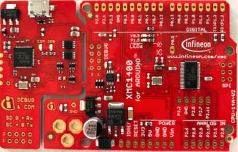
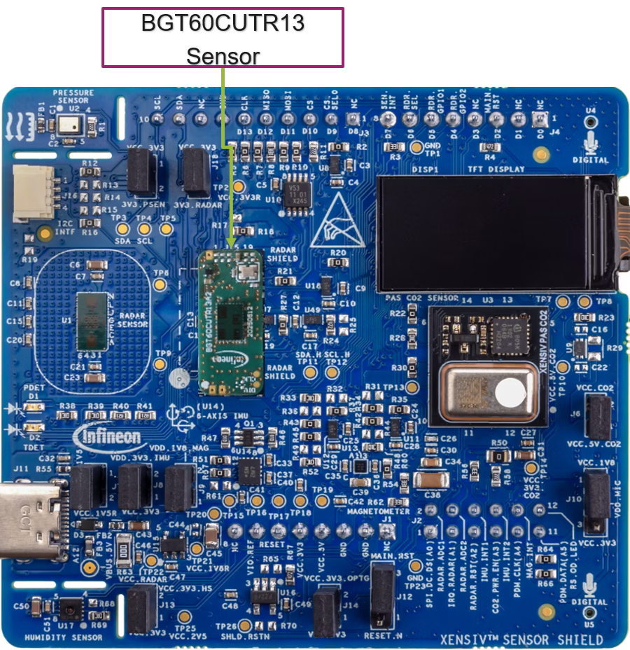

# XENSIV&trade; BGT60CUTRxx radar sensor driver porting guide

## XMC&trade; XMC1400 Arduino Kit edition

**Version:** 1.1 <br>
**Date:** March 2026 <br>
**Author:** Infineon Technologies AG <br>
**Target platform:** KIT_XMC1400_ARDUINO kit with XMC-for-Arduino Core and XENSIV&trade; Sensor Shield with BGT60CUTRxx radar sensor

---

## Table of contents

This guide uses section headers below; in generated Doxygen output, navigation is provided automatically.

---

## Introduction

### Scope

This porting guide provides embedded developers with comprehensive instructions for adapting the Infineon XENSIV&trade; BGT60CUTRxx 60 GHz radar sensor driver to the **KIT_XMC1400_ARDUINO** evaluation board using the **XMC-for-Arduino** ecosystem. Additionally, the guide provides the snippet to showcase the porting of <b>motion detection</b> code example in combination with radar sensor's on-chip capabilities.

The driver follows a layered architecture that separates platform-independent logic from hardware-specific implementations, enabling straightforward porting to the Arduino environment.

**Target audience:**
- Embedded software engineers
- Hardware integration engineers
- Makers and hobbyists working with radar sensing applications

**Target platform:**
- **Arduino baseboard:** KIT_XMC1400_ARDUINO
- **MCU:** XMC1402 (Arm&reg; Cortex&reg;-M0, 48 MHz)

   
- **Sensor daughter board:** XENSIV&trade; Sensor Shield with <b>BGT60CUTR13AIP</b> radar sensor
    


- **Development environment:** Arduino IDE 2.0+ with XMC-for-Arduino Core (v4.0.0+)

### Driver architecture overview

The BGT60CUTRxx driver is designed with portability using a **Hardware Abstraction Layer (HAL)** pattern.

**Table 1.  HAL pattern**

Layer | Description | Modification required
-------|-------------|----------------------
**Core driver** | Platform-independent radar control logic | ❌ No
**Register definitions** | Sensor register maps and bit definitions | ❌ No
**Platform HAL** | Hardware-specific implementations | ✅ Yes
**Motion detector** | Clustering and clutter localization algorithms | ❌ No

<br>

**Key features:**
- 60 GHz FMCW radar sensor support
- Motion detection with clustering algorithms
- Clutter localization capabilities
- FIFO data acquisition
- ADC calibration routines
- Configurable interrupt handling
- Support for 40 MHz and 80 MHz external crystal frequencies
- I/O voltage level configuration (1.2 V/1.8 V)

### Driver package file structure

```
sensor-xensiv-bgt60cutrxx/
├── x.x.x/
│   ├── xensiv_bgt60cutrxx.h              # Main driver API header
│   ├── xensiv_bgt60cutrxx.c              # Core driver implementation
│   ├── xensiv_bgt60cutrxx_regs.h         # Register definitions extension
│   ├── xensiv_bgt60cutrxx_platform.h     # Platform function declarations
│   │
│   ├── register_hal/
│   │   └── xensiv_bgt60cutrxxb_register_hal.h  # Base register definitions
│   │
│   ├── platform/
│   │   └── mtb/                          # Reference PSOC 6(TM)/ModusToolbox(TM) implementation, add your platform-specific definitions here
│   │       ├── xensiv_bgt60cutrxx_mtb.h
│   │       └── xensiv_bgt60cutrxx_mtb.c
│   │
│   ├── motion_detector/
│   │   ├── radar_motion_detection.h      # Motion detection API
│   │   ├── radar_motion_detection.c      # Motion detection implementation
│   │   ├── radar_clustering.h            # Clustering algorithm API
│   │   ├── radar_clustering.c            # Clustering implementation
│   │   ├── radar_clutter_localization.h  # Clutter localization API
│   │   ├── radar_clutter_localization.c  # Clutter localization implementation
│   │   ├── dbscan.h                      # DBSCAN clustering header
│   │   └── dbscan.c                      # DBSCAN clustering implementation
│   │
│   ├── radar_fifo/
│       ├── radar_fifo_read.h             # FIFO read utilities
│       └── radar_fifo_read.c
```

---

## Porting checklists

### Hardware requirements

#### Essential hardware connections

**Table 2. Hardware connections**

Signal | Direction | Description | Required
--------|-----------|-------------|----------
**SPI_MOSI** | MCU → Radar | Master Out Slave In | ✅
**SPI_MISO** | Radar → MCU | Master In Slave Out | ✅
**SPI_CLK** | MCU → Radar | SPI clock | ✅ Yes
**SPI_CS** | MCU → Radar | Chip Select (Active Low) | ✅
**RST** | MCU → Radar | Hardware reset (Active Low) | ✅
**IRQ** | Radar → MCU | Interrupt output | ⚠️ Optional*
**RS_SEL** | MCU → Shield | Radar sensor select | ✅ Shield
**SPI_CS_SEL0** | MCU → Shield | SPI CS multiplexer select | ✅ Shield
**DIO2** | MCU → Radar | Bootloader disable | ✅ Shield
**VDD** | Power | 1.8 V or 3.3 V supply | ✅
**GND** | Power | Ground reference | ✅

<br>

> ⚠️ **Note:** In **Table 2**, the interrupt marked as optional because polling can be used as an alternative; however, this example uses a hardware interrupt.

#### Power supply requirements

**Table 3. Power supply requirements**

Parameter | Value | Notes
-----------|-------|-------
VDD supply | 1.8 V typical | Check sensor variant
VDDIO | 1.2 V or 1.8 V | Configurable via `IO_CTRL` register
Current (Active) | ~10 mA typical | During radar operation
Current (Sleep) | <1µA | Deep sleep mode

<br>

### SPI configuration requirements

> ⚠️ **CRITICAL:** The BGT60CUTRxx radar sensor mandates a specific SPI configuration for correct configuration.

#### SPI parameters

**Table 4. SPI parameters**

Parameter | Required value | Notes
-----------|----------------|-------
**Data Width** | 16-bit | Driver uses 16-bit word transfers ⚠️
**Bit Order** | LSB First | Default configuration
**Clock Polarity (CPOL)** | 0 | Clock idle low
**Clock Phase (CPHA)** | 0 | Sample on leading edge
**SPI Mode** | Mode 0 | CPOL=0, CPHA=0
**Max Clock Speed** | 25 MHz | Currently using 4 MHz
**Chip Select** | Software controlled | Manual CS assertion required

<br>

> **Note**: ⚠️ The driver is designed for 16‑bit SPI transfers; however, platforms that implement 8‑bit transfers can still achieve correct read and write operations by adhering to the required command sequence.

### GPIO requirements

**Table 5. GPIO requirements**

GPIO function | Type | Active level | Notes |
---------------|------|--------------|-------|
**Reset Pin (RSTN)** | Output, Push-Pull | Active LOW | Must support >1 ms pulse
**CS Pin** | Output, Push-Pull | Active LOW | Software-controlled
**IRQ Pin** | Input, Pull-down | Active HIGH | Rising edge interrupt
**RS_SEL** | Output, Push-Pull | Active HIGH | Selects BGT60CUTRxx on shield
**SPI_CS_SEL0** | Output, Push-Pull | Active LOW | CS multiplexer control
**DIO2** | Output, Push-Pull | Active HIGH | Disables bootloader mode

<br>

### Software prerequisites

#### Required tools
- **Arduino IDE:** Version 2.0 or later
- **XMC-for-Arduino Core:** Version 4.0.0 or later
- **SEGGER J-Link:** Latest version for programming/debugging
- **Python 3.x:** With `pyserial` package installed

#### Required standard libraries
```c
#include <stdint.h>   // uint8_t, uint16_t, uint32_t, int32_t
#include <stdbool.h>  // bool, true, false
#include <stddef.h>   // NULL, size_t
#include <SPI.h>      // Arduino SPI library
```
---

## Driver architecture

### Platform-independent layer

The core driver (`xensiv_bgt60cutrxx.c`) provides all radar control functionality:

#### Main data structure

```c
typedef struct
{
    void* iface;                              // Platform-specific interface pointer
    bool xosc_active;                         // External oscillator state
    uint32_t device_id;                       // Hardware device ID
    xensiv_bgt60cutrxx_sleep_mode_t mode;     // Current sleep mode
    xensiv_bgt60cutrxx_clk_t clk_freq_xtal;   // Crystal frequency (40/80 MHz)
    xensiv_bgt60cutrxx_io_level_t io_level;   // IO voltage level (1.2 V/1.8 V)
} xensiv_bgt60cutrxx_t;
```

#### Core API functions

**Table 6. Core API functions**

Function | Description
----------|-------------
`xensiv_bgt60cutrxx_init()` | Initializes sensor with clock and I/O settings
`xensiv_bgt60cutrxx_detect_device()` | Verifies sensor presence via hardware ID
`xensiv_bgt60cutrxx_config()` | Writes register configuration array
`xensiv_bgt60cutrxx_hard_reset()` | Performs hardware reset sequence
`xensiv_bgt60cutrxx_soft_reset()` | Performs software reset
`xensiv_bgt60cutrxx_perform_adc_calibration()` | Executes ADC calibration
`xensiv_bgt60cutrxx_get_fifo()` | Reads FIFO data
`xensiv_bgt60cutrxx_get_rd_map()` | Reads Range-Doppler map
`xensiv_bgt60cutrxx_trigger_sequence0()` | Starts measurement sequence
`xensiv_bgt60cutrxx_get_irq_status()` | Reads interrupt status register
`xensiv_bgt60cutrxx_set_irq_clear()` | Clears interrupt flags

<br>

#### Status codes

```c
#define XENSIV_BGT60CUTRXX_STATUS_OK                    (0)
#define XENSIV_BGT60CUTRXX_STATUS_INVALID_POINTER       (-1)
#define XENSIV_BGT60CUTRXX_STATUS_INVALID_PARAMETER     (-2)
#define XENSIV_BGT60CUTRXX_STATUS_NO_MEMORY             (-3)
#define XENSIV_BGT60CUTRXX_STATUS_SPI_ERROR             (-4)
#define XENSIV_BGT60CUTRXX_STATUS_DEV_ERROR             (-5)
#define XENSIV_BGT60CUTRXX_STATUS_TIMEOUT_ERROR         (-6)
#define XENSIV_BGT60CUTRXX_STATUS_ADC_CALIBRATION_ERROR (-7)
```

### Platform-dependent Hardware Abstraction Layer (HAL)

Implement these six functions declared in `xensiv_bgt60cutrxx_platform.h`:

```c
// Delays functions
void xensiv_bgt60cutrxx_platform_delay(uint32_t ms);
void xensiv_bgt60cutrxx_platform_delay_us(uint32_t us);

// GPIO control
void xensiv_bgt60cutrxx_platform_rst_set(const void* iface, bool val);
void xensiv_bgt60cutrxx_platform_spi_cs_set(const void* iface, bool val);

// SPI communication
int32_t xensiv_bgt60cutrxx_platform_spi_transfer16(void* iface,
    const uint16_t* txd, uint16_t* rxd, uint32_t len);
int32_t xensiv_bgt60cutrxx_platform_spi_read_block(void* iface,
    const uint16_t* txd, uint16_t* rxd, uint32_t len);

// Debug assertion
void xensiv_bgt60cutrxx_platform_assert(bool expr);
```

### Block diagram

```
┌─────────────────────────────────────────────────────────────────────────────┐
│                           APPLICATION LAYER                                 │
│   ┌─────────────────┐  ┌─────────────────┐  ┌─────────────────┐             │
│   │ Motion Detection│  │   Clustering    │  │    Clutter      │             │
│   │   Application   │  │   Algorithm     │  │  Localization   │             │
│   └────────┬────────┘  └────────┬────────┘  └────────┬────────┘             │
└────────────┼────────────────────┼────────────────────┼──────────────────────┘
             │                    │                    │
             ▼                    ▼                    ▼
┌─────────────────────────────────────────────────────────────────────────────┐
│                    MOTION DETECTOR LIBRARY                                  │
│  ┌─────────────────────────────────────────────────────────────────────┐    │
│  │  radar_motion_detection.c  │  radar_clustering.c  │  dbscan.c       │    │
│  └─────────────────────────────────────────────────────────────────────┘    │
└─────────────────────────────────────────────────────────────────────────────┘
                                   │
                                   ▼
┌─────────────────────────────────────────────────────────────────────────────┐
│                    CORE DRIVER (Platform-Independent)                       │
│  ┌─────────────────────────────────────────────────────────────────────┐    │
│  │                    xensiv_bgt60cutrxx.c/.h                          │    │
│  │  ┌──────────┐ ┌──────────┐ ┌──────────┐ ┌──────────┐ ┌──────────┐   │    │
│  │  │  Init &  │ │ Register │ │   FIFO   │ │Interrupt │ │   ADC    │   │    │
│  │  │  Config  │ │  Access  │ │  Control │ │ Handling │ │  Calib   │   │    │
│  │  └──────────┘ └──────────┘ └──────────┘ └──────────┘ └──────────┘   │    │
│  └─────────────────────────────────────────────────────────────────────┘    │
│  ┌─────────────────────────────────────────────────────────────────────┐    │
│  │              Register Definitions                                   │    │
│  │    xensiv_bgt60cutrxx_regs.h + xensiv_bgt60cutrxxb_register_hal.h   │    │
│  └─────────────────────────────────────────────────────────────────────┘    │
└─────────────────────────────────────────────────────────────────────────────┘
                                   │
                                   ▼
┌─────────────────────────────────────────────────────────────────────────────┐
│              PLATFORM ABSTRACTION LAYER (HAL) - YOU IMPLEMENT               │
│  ┌─────────────────────────────────────────────────────────────────────┐    │
│  │           xensiv_bgt60cutrxx_platform_arduino.cpp                   │    │
│  │  ┌──────────────┐ ┌──────────────┐ ┌──────────────┐                 │    │
│  │  │    Delay     │ │     GPIO     │ │     SPI      │                 │    │
│  │  │  Functions   │ │   Control    │ │   Transfer   │                 │    │
│  │  │              │ │              │ │              │                 │    │
│  │  │ • delay()    │ │ • rst_set()  │ │• transfer16()│                 │    │
│  │  │ • delayUs()  │ │ • cs_set()   │ │• read_block()│                 │    │
│  │  └──────────────┘ └──────────────┘ └──────────────┘                 │    │
│  └─────────────────────────────────────────────────────────────────────┘    │
└─────────────────────────────────────────────────────────────────────────────┘
                                   │
                                   ▼
┌─────────────────────────────────────────────────────────────────────────────┐
│                    ARDUINO / XMC-for-Arduino APIs                           │
│  ┌──────────────┐  ┌──────────────┐  ┌──────────────┐                       │
│  │   delay()    │  │ digitalWrite │  │  SPI.h       │                       │
│  │   delayMicro │  │ pinMode()    │  │  transfer16  │                       │
│  └──────────────┘  └──────────────┘  └──────────────┘                       │
└─────────────────────────────────────────────────────────────────────────────┘
                                   │
                                   ▼
┌─────────────────────────────────────────────────────────────────────────────┐
│                    BGT60CUTRxx RADAR SENSOR                                 │
│  ┌─────────────────────────────────────────────────────────────────────┐    │
│  │   ┌─────┐    ┌─────┐    ┌─────┐    ┌─────┐    ┌─────┐    ┌─────┐    │    │
│  │   │ SPI │    │ RST │    │ IRQ │    │DIO2 │    │ VDD │    │ GND │    │    │
│  │   └─────┘    └─────┘    └─────┘    └─────┘    └─────┘    └─────┘    │    │
│  └─────────────────────────────────────────────────────────────────────┘    │
└─────────────────────────────────────────────────────────────────────────────┘
```

---

## Hardware interface specifications

### SPI bus timing diagram

The BGT60CUTRxx radar sensor uses 16-bit SPI transfers with LSB-first bit ordering:

```
CS
        │                                                            │
        └────────────────────────────────────────────────────────────┘

CLK ────────┬──┬──┬──┬──┬──┬──┬──┬──┬──┬──┬──┬──┬──┬──┬──┬──┬─────
            │  │  │  │  │  │  │  │  │  │  │  │  │  │  │  │  │
              0  1  2  3  4  5  6  7  8  9  10 11 12 13 14 15

MOSI ────┼──┼──┼──┼──┼──┼──┼──┼──┼──┼──┼──┼──┼──┼──┼──┼──┼─────
         │D0│D1│D2│D3│D4│D5│D6│D7│D8│D9│D10│D11│D12│D13│D14│D15│
         └──┴──┴──┴──┴──┴──┴──┴──┴──┴──┴──┴──┴──┴──┴──┴──┘
         LSB                                            MSB

MISO ────┼──┼──┼──┼──┼──┼──┼──┼──┼──┼──┼──┼──┼──┼──┼──┼──┼─────
         │D0│D1│D2│D3│D4│D5│D6│D7│D8│D9│D10│D11│D12│D13│D14│D15│
```

#### SPI protocol format

**Write operation (4 words = 64 bits):**
```
Word 0: [WR_BIT | ADDR[7:0] << 8]  (WR_BIT = 1)
Word 1: [ADDR[15:8]]
Word 2: [DATA[15:0]]
Word 3: [DATA[31:16]]
```

**Read operation (2 words command + 2 words data):**
```
Command:
  Word 0: [ADDR[7:0] << 8]  (WR_BIT = 0)
  Word 1: [ADDR[15:8]]
Response:
  Word 0: [DATA[15:0]]
  Word 1: [DATA[31:16]]
```

### Chip-level pin connections

#### BGT60CUTRxx Shield to XMC1400 Arduino Kit connection diagram

```
    KIT_XMC1400_ARDUINO                XENSIV(TM) Sensor Shield with BGT60CUTR13AIP
    ┌───────────────────┐                    ┌───────────────────┐
    │                   │                    │                   │
    │  SPI_MOSI (D11)───┼──── MOSI ─────────►│ SPI_DI            │
    │                   │                    │                   │
    │  SPI_MISO (D12)◄──┼──── MISO ◄─────────┤ SPI_DO            │
    │                   │                    │                   │
    │  SPI_CLK  (D13)───┼──── SCK ──────────►│ SPI_CLK           │
    │                   │                    │                   │
    │  SPI_CS   (D10)───┼──── CS ───────────►│ SPI_CSN           │
    │                   │                    │                   │
    │  RSTN     (D2)────┼──── RST ──────────►│ RSTN              │
    │                   │                    │                   │
    │  IRQ      (A1)◄───┼──── IRQ ◄──────────┤ IRQ*              │
    │                   │                    │                   │
    │  RS_SEL   (D6)────┼──── SEL ──────────►│ RS_SEL (HIGH)     │
    │                   │                    │                   │
    │  CS_SEL0  (D9)────┼──── SEL0 ─────────►│ SPI_CS_SEL0 (LOW) │
    │                   │                    │                   │
    │  DIO2     (D5)────┼──── DIO2 ─────────►│ DIO2 (HIGH)       │
    │                   │                    │                   │
    │  3.3 V    ────────┼──── VDD ──────────►│ VDD               │
    │                   │                    │                   │
    │  GND      ────────┼──── GND ──────────►│ GND               │
    │                   │                    │                   │
    └───────────────────┘                    └───────────────────┘
```
> **Note:**
- SEL, SEL0, and DIO2 are shield-specific
- As the XMC1400 Arduino kit does not allow interrupt registration on analog pin <b>A1</b>, the interrupt from pin A1 is externally routed to digital pin <b>D3</b>, where IRQ is registered

### Reset timing requirements

```

RST ────┌                                                             ┌────
        │                                                             │
        │─────────────────────────────────────────────────────────────│

        │◄─────────────── ≥1ms (RESET_DELAY_MS) ─────────────────────►│
        │                                                             │
        Power-up                                                Device Ready
```

**Reset sequence:**
1. Asserts RST LOW (active)
2. Waits minimum 1 ms
3. Releases RST HIGH (inactive)
4. Waits for device to initialize (~1 ms for clock setup)

---

## Platform abstraction layer implementation

### Required functions

Create a new source file (e.g., `xensiv_bgt60cutrxx_platform_arduino.cpp`) implementing all platform functions.

### Function specifications

#### Delay functions

```c
/**
 * @brief Millisecond delay
 * @param ms Delay duration in milliseconds
 *
 * Implementation notes:
 * - Must be blocking
 * - Accuracy: ±10% acceptable
 * - Used for reset timing and configuration settling
 */
void xensiv_bgt60cutrxx_platform_delay(uint32_t ms);

/**
 * @brief Microsecond delay
 * @param us Delay duration in microseconds
 *
 * Implementation notes:
 * - Must be blocking
 * - Accuracy: ±20% acceptable for us < 100
 * - Used for ADC calibration polling (100µs intervals)
 */
void xensiv_bgt60cutrxx_platform_delay_us(uint32_t us);
```

#### GPIO control functions

```c
/**
 * @brief Controls reset pin
 * @param iface Platform interface pointer (cast to your interface struct)
 * @param val   true = HIGH (inactive), false = LOW (active reset)
 *
 * Implementation notes:
 * - Reset is ACTIVE LOW
 * - RESET_ACTIVE = 0, RESET_INACTIVE = 1
 */
void xensiv_bgt60cutrxx_platform_rst_set(const void* iface, bool val);

/**
 * @brief Controls SPI Chip Select (CS) pin
 * @param iface Platform interface pointer
 * @param val   true = HIGH (inactive), false = LOW (active/selected)
 *
 * Implementation notes:
 * - CS is ACTIVE LOW
 * - CS_ACTIVE = 0, CS_INACTIVE = 1
 * - Must be manually controlled (not automatic SPI CS)
 */
void xensiv_bgt60cutrxx_platform_spi_cs_set(const void* iface, bool val);
```

#### SPI transfer functions

```c
/**
 * @brief 16-bit SPI transfer
 * @param iface Platform interface pointer
 * @param txd   Transmits buffer (can be NULL for read-only)
 * @param rxd   Receives buffer (can be NULL for write-only)
 * @param len   Number of 16-bit words to transfer
 * @return 0 on success, non-zero on error
 *
 * Implementation notes:
 * - MUST use 16-bit word transfers
 * - LSB first bit order
 * - SPI Mode 0 (CPOL=0, CPHA=0)
 * - If txd is NULL, send 0x0000 for each word
 * - If rxd is NULL, discard received data
 */
int32_t xensiv_bgt60cutrxx_platform_spi_transfer16(void* iface,
    const uint16_t* txd, uint16_t* rxd, uint32_t len);

/**
 * @brief Blocks read via SPI
 * @param iface Platform interface pointer
 * @param txd   Command buffer (2 words: address)
 * @param rxd   Receive buffer for data
 * @param len   Number of 16-bit words to read
 * @return 0 on success, non-zero on error
 *
 * Implementation notes:
 * - First sends 2-word command (txd)
 * - Then reads 'len' words into rxd
 * - Used for FIFO and bulk register reads
 */
int32_t xensiv_bgt60cutrxx_platform_spi_read_block(void* iface,
    const uint16_t* txd, uint16_t* rxd, uint32_t len);
```

#### Assert function

```c
/**
 * @brief Runtime assertion
 * @param expr Expression to verify
 *
 * Implementation notes:
 * - If expr is false, halt execution or log error
 * - Can be empty macro in release builds
 */
void xensiv_bgt60cutrxx_platform_assert(bool expr);
```


## XMC1400 Arduino porting example

This section demonstrates how platform-dependent code is integrated with the required software driver interfaces. After  [Platform implementation files](#platform-implementation-files) integration, [Motion detection application](#motion-detection-application) shows the porting of the <b>motion detection</b> code example that utilizes on-chip capabilities of radar sensor. The code example shows how to use the software driver interfaces to detect the sensor on the bus, configure it for a given use case, and initiate data sampling.

### Hardware setup

**Board information:**
- **MCU:** XMC1402 (Arm&reg; Cortex&reg;-M0, 48 MHz)
- **Development environment:** Arduino IDE with XMC-for-Arduino Core
- **Reference:** [KIT_XMC1400_ARDUINO](https://www.infineon.com/evaluation-board/KIT-XMC1400-ARDUINO)

> ⚠️ **Important Errata:** On the KIT_XMC1400_ARDUINO, pins `P1.4` and `P0.5` are swapped on the board and are not consistent with the silkscreen. As a result, interrupt 0 `INT0` occurs as Arduino pin `25` and interrupt 1 `INT1` is located at Arduino pin `3`. See the [XMC-for-Arduino documentation](https://xmc-arduino.readthedocs.io/en/latest/hw-platforms.html) for the correct pinout diagram.

### Pin mapping

Based on the XENSIV&trade; Radar Shield and XMC1400 Arduino Kit routing:

**Table 7. Pin mapping**

Signal | Arduino pin | XMC1400 pin | Function | Notes
--------|-------------|-------------|----------|-------
SPI_MOSI | D11 | P0.1 | SPI Master Out | -
SPI_MISO | D12 | P0.0 | SPI Master In | -
SPI_CLK | D13 | P0.3 | SPI Clock | -
SPI_CS | D10 | P0.4 | Chip Select | Software controlled |
RSTN | D2 | P1.4→P0.5* | Reset | *See errata 
IRQ | A1 | P2.8 | Interrupt | Rising edge, externally routed to D3 (P1.1)|
RS_SEL | D6 | P0.6 | Radar Select | Set HIGH 
SPI_CS_SEL0 | D9 | P0.7 | CS Mux Select | Set LOW
DIO2 | D5 | P0.2 | Bootloader Disable | Set HIGH

<br>

### Platform implementation files {#platform-implementation-files}

#### File: `xensiv_bgt60cutrxx_platform_arduino.h`

```cpp
/**
 * @file xensiv_bgt60cutrxx_platform_arduino.h
 * @brief BGT60CUTRxx driver port for XMC1400 Arduino Kit
 */

#ifndef XENSIV_BGT60CUTRXX_PLATFORM_ARDUINO_H_
#define XENSIV_BGT60CUTRXX_PLATFORM_ARDUINO_H_

#include <Arduino.h>
#include <SPI.h>

// SPI Pins (Arduino standard)
#define PIN_XENSIV_BGT60CUTRXX_SPI_SCLK   13   // D13 - P0.3
#define PIN_XENSIV_BGT60CUTRXX_SPI_MOSI   11   // D11 - P0.1
#define PIN_XENSIV_BGT60CUTRXX_SPI_MISO   12   // D12 - P0.0
#define PIN_XENSIV_BGT60CUTRXX_SPI_CSN    10   // D10 - P0.4

// Control Pins
#define PIN_XENSIV_BGT60CUTRXX_IRQ        3    // A1 -  If IRQ is supported else for XMC1400 externally routed to pin 3
#define PIN_XENSIV_BGT60CUTRXX_RSTN       2    // D2 - P0.5 (Note: P1.4 swapped with P0.5)

// Shield Control Pins
#define PIN_RS_SEL                        6    // D6 - P0.6 (Radar sensor select)
#define PIN_SHIELD_XENSIV_A_SPI_CS_SEL0   9    // D9 - P0.7 (SPI CS multiplexer)
#define PIN_SHIELD_XENSIV_A_DIO2          5    // D5 - P0.2 (Bootloader disable)

// SPI Configuration
#define SPI_FREQUENCY_HZ                  4000000UL // 4 MHz SPI clock

extern "C" {
#include <xensiv_bgt60cutrxx.h>
#include <xensiv_bgt60cutrxx_platform.h>
#include <xensiv_bgt60cutrxx_regs.h>
#include <register_hal/xensiv_bgt60cutrxxb_register_hal.h>
}

#ifdef DEBUG_PRINT
#undef DEBUG_PRINT
#define DEBUG_PRINT(...) Serial.print(__VA_ARGS__)
#endif

/**
 * @brief Arduino platform interface structure
 */
typedef struct {
    uint8_t cs_pin;      /**< Chip select pin */
    uint8_t rst_pin;     /**< Reset pin */
    uint8_t irq_pin;     /**< Interrupt pin */
} xensiv_bgt60cutrxx_arduino_iface_t;

/**
 * @brief Combined radar device structure for Arduino
 */
typedef struct {
    xensiv_bgt60cutrxx_t dev;
    xensiv_bgt60cutrxx_arduino_iface_t iface;
} xensiv_bgt60cutrxx_arduino_t;

/**
 * @brief Initializes shield-specific GPIO pins
 * @return 0 on success, -1 on failure
 */
int32_t xensiv_bgt60cutrxx_shield_init(void);

/**
 * @brief Initializes radar sensor on Arduino platform
 * @param radar Pointers to radar device structure
 * @param register_list Pointers to register configuration array
 * @param register_list_len Number of register entries
 * @return 0 on success, error code on failure
 */
int32_t xensiv_bgt60cutrxx_arduino_init(
    xensiv_bgt60cutrxx_arduino_t* radar,
    const uint32_t register_list[][2],
    uint32_t register_list_len);

#endif /* XENSIV_BGT60CUTRXX_PLATFORM_ARDUINO_H_ */
```

#### File: `xensiv_bgt60cutrxx_platform_arduino.cpp`

```cpp
/**
 * @file xensiv_bgt60cutrxx_platform_arduino.cpp
 * @brief BGT60CUTRxx driver port for XMC1400 Arduino Kit
 */

#include "xensiv_bgt60cutrxx_platform_arduino.h"

#ifdef DEBUG_PRINT
#undef DEBUG_PRINT
#define DEBUG_PRINT(...) Serial.print(__VA_ARGS__)
#endif

/* ============================================================================
 * Platform function implementations
 * ============================================================================ */

extern "C" {

void xensiv_bgt60cutrxx_platform_delay(uint32_t ms)
{
    delay(ms);
}

void xensiv_bgt60cutrxx_platform_delay_us(uint32_t us)
{
    delayMicroseconds(us);
}

void xensiv_bgt60cutrxx_platform_rst_set(const void* iface, bool val)
{
    const xensiv_bgt60cutrxx_arduino_iface_t* arduino_iface =
        (const xensiv_bgt60cutrxx_arduino_iface_t*)iface;

    digitalWrite(arduino_iface->rst_pin, val ? HIGH : LOW);
}

void xensiv_bgt60cutrxx_platform_spi_cs_set(const void* iface, bool val)
{
    const xensiv_bgt60cutrxx_arduino_iface_t* arduino_iface =
        (const xensiv_bgt60cutrxx_arduino_iface_t*)iface;

    digitalWrite(arduino_iface->cs_pin, val ? HIGH : LOW);
}

int32_t xensiv_bgt60cutrxx_platform_spi_transfer16(void* iface,
    const uint16_t* txd, uint16_t* rxd, uint32_t len)
{
    (void)iface;  // Interfaces not needed for Arduino SPI

    for (uint32_t i = 0; i < len; i++)
    {
        uint16_t tx_word = (txd != NULL) ? txd[i] : 0x0000;

        uint8_t tx_lsb = (uint8_t)(tx_word & 0xFF);
        uint8_t tx_msb = (uint8_t)((tx_word >> 8) & 0xFF);

        uint8_t rx_lsb = SPI.transfer(tx_lsb);
        uint8_t rx_msb = SPI.transfer(tx_msb);

        if (rxd != NULL)
        {
            rxd[i] = ((uint16_t)rx_msb << 8) | rx_lsb;
        }
    }

    return XENSIV_BGT60CUTRXX_STATUS_OK;
}

int32_t xensiv_bgt60cutrxx_platform_spi_read_block(void* iface,
    const uint16_t* txd, uint16_t* rxd, uint32_t len)
{
    int32_t result;

    // Sends 2-word read command
    result = xensiv_bgt60cutrxx_platform_spi_transfer16(iface, txd, NULL, 2);

    if (result == XENSIV_BGT60CUTRXX_STATUS_OK)
    {
        // Reads data words
        result = xensiv_bgt60cutrxx_platform_spi_transfer16(iface, NULL, rxd, len);
    }

    return result;
}

void xensiv_bgt60cutrxx_platform_assert(bool expr)
{
    if (!expr)
    {
        Serial.println("ASSERTION FAILED!");
        while (1) { }  // Halts
    }
}

} // extern "C"

/* ============================================================================
 * Arduino-specific initialization functions
 * ============================================================================ */

int32_t xensiv_bgt60cutrxx_shield_init(void)
{
    // Initializes shield control pins

    // RS_SEL: Selects BGT60CUTRxx as active radar sensor (HIGH)
    pinMode(PIN_RS_SEL, OUTPUT);
    digitalWrite(PIN_RS_SEL, HIGH);

    // SPI_CS_SEL0: Configures CS multiplexer (LOW for BGT60CUTRxx)
    pinMode(PIN_SHIELD_XENSIV_A_SPI_CS_SEL0, OUTPUT);
    digitalWrite(PIN_SHIELD_XENSIV_A_SPI_CS_SEL0, LOW);

    // DIO2: Disables bootloader mode (HIGH)
    // Note: DIO3 is connected to RSTN pin, so it will be set HIGH during reset release
    pinMode(PIN_SHIELD_XENSIV_A_DIO2, OUTPUT);
    digitalWrite(PIN_SHIELD_XENSIV_A_DIO2, HIGH);

    return XENSIV_BGT60CUTRXX_STATUS_OK;
}

int32_t xensiv_bgt60cutrxx_arduino_init(
    xensiv_bgt60cutrxx_arduino_t* radar,
    const uint32_t register_list[][2],
    uint32_t register_list_len)
{
    int32_t result;

    // Stores pin configuration
    radar->iface.cs_pin = PIN_XENSIV_BGT60CUTRXX_SPI_CSN;
    radar->iface.rst_pin = PIN_XENSIV_BGT60CUTRXX_RSTN;
    radar->iface.irq_pin = PIN_XENSIV_BGT60CUTRXX_IRQ;

    // Initializes GPIO pins
    pinMode(radar->iface.cs_pin, OUTPUT);
    pinMode(radar->iface.rst_pin, OUTPUT);
    pinMode(radar->iface.irq_pin, INPUT_PULLDOWN);

    // Sets initial states
    digitalWrite(radar->iface.cs_pin, HIGH);   // CS inactive
    digitalWrite(radar->iface.rst_pin, HIGH);  // RST inactive

    // Initializes shield-specific pins
    result = xensiv_bgt60cutrxx_shield_init();
    if (result != XENSIV_BGT60CUTRXX_STATUS_OK)
    {
        return result;
    }

    // Initializes SPI
    SPISettings radarSPISettings(SPI_FREQUENCY_HZ, LSBFIRST, SPI_MODE0);
    SPI.beginTransaction(radarSPISettings);


    // Initializes radar driver
    // 80 MHz crystal, 1.8 V I/O level (typical for XENSIV(TM) shield)
    result = xensiv_bgt60cutrxx_init(
        &radar->dev,
        &radar->iface,
        BGT60CUTRXX_CLK_80MHZ,
        BGT60CUTRXX_IO_LEVEL_1V8
    );

    if (result != XENSIV_BGT60CUTRXX_STATUS_OK)
    {
        Serial.println("xensiv_bgt60cutrxx_init failed");
        return result;
    }

    // Detects device
    result = xensiv_bgt60cutrxx_detect_device(&radar->dev);
    if (result != XENSIV_BGT60CUTRXX_STATUS_OK)
    {
        Serial.println("xensiv_bgt60cutrxx_detect_device failed");
        return result;
    }

    Serial.print("Radar HW ID: 0x");
    Serial.println(radar->dev.device_id, HEX);

    // Loads configuration
    result = xensiv_bgt60cutrxx_config(&radar->dev, register_list, register_list_len);
    if (result != XENSIV_BGT60CUTRXX_STATUS_OK)
    {
        Serial.println("xensiv_bgt60cutrxx_config failed");
        return result;
    }

    // Waits for configuration to settle
    delay(50);

    // Performs ADC calibration
    result = xensiv_bgt60cutrxx_perform_adc_calibration(&radar->dev);
    if (result != XENSIV_BGT60CUTRXX_STATUS_OK)
    {
        Serial.println("ADC calibration failed");
        return result;
    }

    Serial.println("Radar sensor initialized successfully");
    return XENSIV_BGT60CUTRXX_STATUS_OK;
}
```

### Motion detection application {#motion-detection-application}

#### File: `radar_motion_detection.ino`

```cpp
/**
 * @file radar_motion_detection.ino
 * @brief Motion detection example for XMC1400 Arduino Kit with BGT60CUTRxx
 *
 * This example demonstrates radar motion detection using the XENSIV(TM) BGT60CUTRxx
 * sensor on the KIT_XMC1400_ARDUINO evaluation board.
 */

#include <xensiv_bgt60cutrxx.h>
#include <xensiv_bgt60cutrxx_platform.h>
#include <xensiv_bgt60cutrxx_regs.h>

#include <SPI.h>
#include "xensiv_bgt60cutrxx_platform_arduino.h"

// Includes radar configuration header (from radar_config folder)
#include "radar_config/indoor_motion_low_power.h"

// Includes motion detection library
extern "C" {
#include "motion_detector/radar_motion_detection.h"
}

/* ============================================================================
 * Configuration
 * ============================================================================ */

#define SERIAL_BAUDRATE     115200
#define LOOP_DELAY_MS       5


/* ============================================================================
 * Global variables
 * ============================================================================ */

// Radar sensor object
static xensiv_bgt60cutrxx_arduino_t radar_sensor;

// Motion detection object
static motion_detection_t motion_detection;

// Range-Doppler data buffer (if enabled)
#ifdef RADAR_MOTION_DETECTION_USE_RD_BUFFER
static uint32_t rd_data_buffer[BGT60CUTR13_RD_DATABUFFER_MAX_SIZE];
#else
static uint32_t rd_data_buffer[1];  // Minimal buffer
#endif

// Interrupts flag
static volatile bool radar_event_irq = true;

// Detection counter
static uint32_t detection_counter = 0;

/* ============================================================================
 * Interrupt handler
 * ============================================================================ */

void radar_irq_handler(void)
{
    radar_event_irq = true;

}

/* ============================================================================
 * Helper functions
 * Prints detections in JSON-based format to support the Infineon XENSIV(TM) radar CMOS visualization tool.
 See: https://www.infineon.com/design-resources/development-tools
 ============================================================================
 */

void print_detections(motion_detection_t* motion_detection, uint32_t counter)
{
    // Uses a slightly larger buffer to be safe and initialize to zero
    static char buffer[256];
    static char f1[16], f2[16], f3[16], f4[16], f5[16], f6[16];
    uint16_t type = 0;
    bool target_detected = false;

    if (motion_detection == NULL) return;

    // Hard reset of the buffer to prevent trailing garbage
    memset(buffer, 0, sizeof(buffer));

    // Part 1: Header
    int len = snprintf(buffer, sizeof(buffer) - 1, "{\"ts\": %" PRIu32 ", \"detections\": {", counter);
    if (len > 0) Serial.print(buffer);

    // Part 2: Attributes (Static string, no buffer needed)
    Serial.print("\"attributes\":[\"range\",\"azimuth\",\"elevation\",\"magnitude\",\"speed\",\"rx\",\"range_bin\",\"doppler_bin\",\"sequence\",\"type\",\"seq_count_1\",\"seq_count_2\",\"ir_stat\"], \"data\": [");

    if (motion_detection->seq1_done) type = 1;
    else if (motion_detection->seq2_done) type = 2;
    else type = 0;

    for (uint8_t i = 0; i < BGT60CUTR13_PROCESSED_MD_TARGET_MAX; i++)
    {
        if ((motion_detection->processed_targets[i].antenna_rx > 0) ||
            ((i == (BGT60CUTR13_PROCESSED_MD_TARGET_MAX - 1)) && !target_detected))
        {
            if (target_detected)
            {
                Serial.print(", ");
            }
            target_detected = true;

            // Converts floats safely
            dtostrf(motion_detection->processed_targets[i].range_m, 1, 2, f1);
            dtostrf(motion_detection->processed_targets[i].azimuth_deg, 1, 2, f2);
            dtostrf(motion_detection->processed_targets[i].elevation_deg, 1, 2, f3);
            dtostrf(motion_detection->processed_targets[i].magnitude_dBFS, 1, 2, f4);
            dtostrf(motion_detection->processed_targets[i].velocity_mps, 1, 2, f5);
            // Clears buffer before each target print
            memset(buffer, 0, sizeof(buffer));
            len = snprintf(buffer, sizeof(buffer) - 1, "[%s, %s, %s, %s, %s, %d, %d, %d, %d, %d, %d, %d, %" PRIu32 "]",
                   f1, f2, f3, f4, f5,
                   (int)motion_detection->processed_targets[i].antenna_rx,
                   (int)motion_detection->range_bin[i],
                   (int)motion_detection->doppler_bin[i],
                   (int)motion_detection->sequence,
                   (int)type,
                   (int)motion_detection->sequence_counters.seq1_counter,
                   (int)motion_detection->sequence_counters.seq2_counter,
                   motion_detection->ir_stat);

            if (len > 0) {
                buffer[sizeof(buffer) - 1] = '\0'; // Force termination
                Serial.print(buffer);
            }
        }
    }

    // Part 3: Footer
    Serial.println("]}}");
}

/* ============================================================================
 * Setup
 * ============================================================================ */

void setup()
{
    int32_t result;

    //Register external interrupt first
    /* Note: For XMC1400 Arduino, the A1 pin is not designated as an INTR pin. Therefore, this example expects pin A1 to be externally connected to pin #3 (P1.1), where INTR is registered. For other Arduino platforms, where A1 can be directly used as INTR, this is however not needed.*/
    attachInterrupt(
        digitalPinToInterrupt(PIN_XENSIV_BGT60CUTRXX_IRQ),
        radar_irq_handler,
        RISING
    );

    // Initializes serial communication
    Serial.begin(SERIAL_BAUDRATE);

    while (!Serial) { }  // Wait for serial port

    delay(1000);  // Allows time for serial monitor to connect

    // Prints banner
    Serial.println();
    Serial.println("========================================");
    Serial.println("XENSIV BGT60CUTRxx Motion Detection");
    Serial.println("XMC1400 Arduino Kit Example");
    Serial.println("========================================");
    Serial.println();

    // Initializes radar sensor
    Serial.println("Initializing radar sensor...");

    result = xensiv_bgt60cutrxx_arduino_init(
        &radar_sensor,
        register_list,
        sizeof(register_list) / sizeof(register_list[0])
    );

    if (result != XENSIV_BGT60CUTRXX_STATUS_OK)
    {
        Serial.print("ERROR: Radar initialization failed with code: ");
        Serial.println(result);
        while (1) { }  // Halts
    }

    Serial.println("Radar sensor initialized successfully");

    // Initializes motion detection
    Serial.println("Initializing motion detection...");

#if MD_RD_ENABLED
    static const float rd_velocity_grid[] = RD_VELOCITY_GRID_MPS;
    static const sequence_settings_t rd_sequence_settings = {
        .enabled            = true,
        .range_resolution_m = RD_RANGE_RESOLUTION_M,
        .velocity_grid_mps  = rd_velocity_grid
    };
#else
   static const sequence_settings_t rd_sequence_settings = {0};
#endif

#if MD_ULP_ENABLED
    static const float ulp_velocity_grid[] = ULP_VELOCITY_GRID_MPS;
    static const sequence_settings_t ulp_sequence_settings = {
        .enabled            = true,
        .range_resolution_m = ULP_RANGE_RESOLUTION_M,
        .velocity_grid_mps  = ulp_velocity_grid
    };
#else
    static const sequence_settings_t ulp_sequence_settings = {0};
#endif

    result = radar_motion_detection_init(
        &motion_detection,
        &radar_sensor.dev,
        rd_data_buffer,
        &rd_sequence_settings,
        &ulp_sequence_settings
    );

    if (result != XENSIV_BGT60CUTRXX_STATUS_OK)
    {
        Serial.print("ERROR: Motion detection init failed with code: ");
        Serial.println(result);
        while (1) { }  // Halts
    }

    Serial.println("Motion detection initialized successfully");


    // Clears any pending interrupts
    radar_event_irq = false;
    uint32_t irq_status = 0;
    xensiv_bgt60cutrxx_get_irq_status(&radar_sensor.dev, &irq_status);
    Serial.print("Initial IR_STAT: 0x");
    Serial.println(irq_status, HEX);

    Serial.println();
    Serial.println("========================================");
    Serial.println("Motion detection started!");
    Serial.println("========================================");
    Serial.println();

    delay(50);

    xensiv_bgt60cutrxx_set_irq_clear(&radar_sensor.dev,
        BGT60CUTR13B_IR_CLEAR_FOR_STARTUP_MSK);


}

/* ============================================================================
 * Main loop
 * ============================================================================ */

void loop()
{

    //Monitors the IRQ
    if (radar_event_irq){

        radar_event_irq = false;
        // Processes radar data
        radar_motion_detection_process(&motion_detection);

        // Prints detection results
        print_detections(&motion_detection, detection_counter);

        detection_counter++;

    }

    delay(LOOP_DELAY_MS);
}

```
---

## Build and run instructions

### Arduino IDE setup

#### Prerequisites

1. **Install Arduino IDE 2.0+**
   - Download from [Arduino Software](https://www.arduino.cc/en/software)

2. **Install SEGGER J-Link**
   - Download from [SEGGER J-Link Downloads](https://www.segger.com/downloads/jlink/)
   - Install the "J-Link Software and Documentation Pack"
   - Ensure "Install USB Driver for J-Link" is checked during installation

3. **Install Python 3.x with pyserial**
   ```bash
   python -m pip install pyserial
   ```

4. **Install XMC-for-Arduino Core**
   - Open Arduino IDE
   - Go to **File** → **Preferences**
   - Add the following URL to "Additional boards manager URLs":
     ```
     https://github.com/Infineon/XMC-for-Arduino/releases/download/latest-3.x/package_infineon_index.json
     ```
   - Go to **Tools** → **Board** → **Boards Manager**
   - Search for "XMC" and install "XMC Family"

5. **Prepare and add BGT60CUTRxx software driver as Arduino Library**
   - Locate the BGT60CUTRxx software driver folder on your system
   - Organize it with the required structure:
     ```
     sensor-xensiv-bgt60cutrxx/
     ├── library.properties
     └── src/
         ├── xensiv_bgt60cutrxx.h      # From software driver library package
         ├── xensiv_bgt60cutrxx.c
         ├── xensiv_bgt60cutrxx_regs.h
         ├── xensiv_bgt60cutrxx_platform.h
         │
         ├── xensiv_bgt60cutrxxb_register_hal.h
         │
         ├── motion_detector/
         │   ├── radar_motion_detection.h
         │   ├── radar_motion_detection.c
         │   ├── radar_clustering.h
         │   ├── radar_clustering.c
         │   ├── radar_clustering_internal.h
         │   ├── radar_clutter_localization.h
         │   ├── radar_clutter_localization.c
         │   ├── radar_clutter_localization_internal.h
         │   ├── dbscan.h
         │   └── dbscan.c
         │
         └── radar_fifo/
             ├── radar_fifo_read.h
             └── radar_fifo_read.c
     ```

       > **Note**: File  <b>xensiv_bgt60cutrxxb_register_hal.h</b> is moved from directory <b>register_hal</b> to <b>src</b> directory.
   - Create `library.properties` in the root of the folder:
     ```ini
     name=Sensor XENSIV BGT60CUTRxx
     version=1.0.0
     author=Infineon
     maintainer=Infineon
     sentence=SW driver for BGT60cutrxx radar sensor
     category=Sensors
     url=https://github.com/Infineon
     architectures=xmc
     sentence=SW Driver for BGT60CUTRxx radar sensor
     paragraph=Provides driver support for BGT60CUTRxx radar sensor family

     ```
   - Copy the `sensor-xensiv-bgt60cutrxx/` folder to:
     ```
     C:\Users\<YourUsername>\Documents\Arduino\libraries\
     ```
   - Restart Arduino IDE
   - Verify it appears under **Sketch** → **Include Library** → **Contributed Libraries**

6. **Select board**
   - Go to **Tools** → **Board** → **XMC Family**
   - Select **KIT_XMC1400_ARDUINO**

### Project structure

Create the following folder structure in your Arduino sketch folder:

```
radar_motion_detection/
├── radar_motion_detection.ino                  # Main sketch
├── xensiv_bgt60cutrxx_platform_arduino.h       # Arduino specific port
├── xensiv_bgt60cutrxx_platform_arduino.cpp     # Arduino specific port
├── radar_config/
│   └── indoor_motion_low_power.h               # Radar configuration
```
> **Note:** `indoor_motion_low_power.h` is a generated radar sensor configuration file provided as part of the motion detection code example in the Infineon ModusToolbox&trade; release.

### Building and uploading

1. **Connect hardware**
   - Connect the XENSIV&trade; Radar Shield to the KIT_XMC1400_ARDUINO
   - Connect the board to your PC via USB

2. **Select port**
   - Go to **Tools** → **Port**
   - Select the COM port for your XMC1400 board

3. **Compile**
   - Click the **Verify** button (checkmark) or press `Ctrl+R`
   - Verify that compilation completes without errors

4. **Upload**
   - Click the **Upload** button (arrow) or press `Ctrl+U`
   - Wait for upload to complete

5. **Monitor output**
   - Open **Tools** → **Serial Monitor**
   - Set baud rate to **115200**
   - Observe motion detection output

---

## Testing and validation

### Basic connectivity test

```cpp
int32_t test_radar_connectivity(xensiv_bgt60cutrxx_t* dev)
{
    uint32_t spi_ctrl;
    int32_t status;

    // Reads SPI_CTRL register, should return reset value
    status = xensiv_bgt60cutrxx_get_reg(dev, BGT60CUTR13B_REG_SPI_CTRL, &spi_ctrl);

    if (status != XENSIV_BGT60CUTRXX_STATUS_OK)
    {
        Serial.println("ERROR: SPI communication failed");
        return status;
    }

    // SPICTRL shall not be zero
    Serial.print("SPI_CTRL: 0x");
    Serial.println(spi_ctrl, HEX);

    return XENSIV_BGT60CUTRXX_STATUS_OK;
}
```

### Device ID verification

```cpp
int32_t test_device_id(xensiv_bgt60cutrxx_t* dev)
{

    uint32_t id;
    int32_t status = xensiv_bgt60cutrxx_get_reg(dev, (BGT60CUTR13B_REG_ID_HW), &id);

    if (XENSIV_BGT60CUTRXX_STATUS_OK == status)
    {
        if (xensiv_bgt60cutrxx_is_bgt60cutrxx(id))
        {
            dev->device_id = id;
        }
        else
        {
            status = XENSIV_BGT60CUTRXX_STATUS_DEV_ERROR;
        }
    }

}
```

### ADC calibration test

```cpp
int32_t test_adc_calibration(xensiv_bgt60cutrxx_t* dev)
{
    int32_t status;
    uint32_t adc_err;

    status = xensiv_bgt60cutrxx_perform_adc_calibration(dev);

    if (status != XENSIV_BGT60CUTRXX_STATUS_OK)
    {
        xensiv_bgt60cutrxx_get_reg(dev, BGT60CUTR13B_REG_ADC_ERR_CTRL, &adc_err);
        Serial.print("ADC calibration failed. Error register: 0x");
        Serial.println(adc_err, HEX);
        return status;
    }

    Serial.println("ADC calibration successful");
    return XENSIV_BGT60CUTRXX_STATUS_OK;
}
```

---

## Troubleshooting

### Common issues and solutions

**Table 8. Troubleshooting**

Issue | Possible cause | Solution
-------|----------------|----------
**Device not detected** | SPI wiring incorrect | Verify MOSI, MISO, CLK, CS connections
**Wrong HW ID** | SPI mode incorrect | Ensure Mode 0, LSB first, 16-bit
**ADC calibration fails** | Configuration not loaded | Load register config before calibration
**No interrupts** | IRQ pin not configured | Check IRQ pin and interrupt setup
**Garbled serial output** | Baud rate mismatch | Verify serial monitor baud rate
**Upload fails** | J-Link not installed | Install SEGGER J-Link software

<br>

### Debug checklist

1. **SPI communication**
   - [ ] SPI Mode 0 (CPOL=0, CPHA=0)
   - [ ] LSB first bit order
   - [ ] 16-bit data width
   - [ ] CS manually controlled (not automatic)
   - [ ] Clock speed ≤ 25 MHz

2. **GPIO configuration**
   - [ ] CS pin configured as output, initially HIGH
   - [ ] RST pin configured as output, initially HIGH
   - [ ] IRQ pin configured as input
   - [ ] Shield control pins (RS_SEL, CS_SEL0, DIO2) set correctly

3. **Power supply**
   - [ ] VDD connected and stable
   - [ ] GND connected
   - [ ] IO voltage level matches configuration

4. **Reset sequence**
   - [ ] RST held LOW for ≥5ms
   - [ ] Wait after RST release for device initialization

### Enabling debug output

Add the following define before including driver headers to enable debug prints:

```cpp
#define DEBUG_PRINT_ENABLE
#include "xensiv_bgt60cutrxx_platform.h"
```

---

## References

### Documentation

- [XENSIV&trade; BGT60CUTRxx datasheet](https://www.infineon.com/products/sensor/radar-sensors/radar-sensors-for-iot/60ghz-radar)
- [KIT_XMC1400_ARDUINO](https://www.infineon.com/evaluation-board/KIT-XMC1400-ARDUINO)
- [XMC-for-Arduino Documentation](https://xmc-arduino.readthedocs.io/en/latest/)
- [XMC-for-Arduino GitHub Repository](https://github.com/Infineon/XMC-for-Arduino)

### Related-software

- [Arduino IDE](https://www.arduino.cc/en/software)
- [SEGGER J-Link Software](https://www.segger.com/downloads/jlink/)
- [ModusToolbox&trade](https://www.infineon.com/modustoolbox) (Reference implementation platform)

---

## Appendix A: Register configuration example

The radar configuration is typically generated using Infineon radar configuration tools and a minimal example structure as follows:

```c
// radar_config/indoor_motion_low_power.h

#ifndef INDOOR_MOTION_LOW_POWER_H_
#define INDOOR_MOTION_LOW_POWER_H_

// Motion detection configuration flags
#define MD_RD_ENABLED   1
#define MD_ULP_ENABLED  1

// Range-Doppler sequence settings
#define RD_RANGE_RESOLUTION_M   0.15f
#define RD_VELOCITY_GRID_MPS    {-2.0f, -1.0f, 0.0f, 1.0f, 2.0f}

// Ultra-low power sequence settings
#define ULP_RANGE_RESOLUTION_M  0.30f
#define ULP_VELOCITY_GRID_MPS   {-1.0f, 0.0f, 1.0f}

// Register configuration array
// Format: {register_address, register_value}
static const uint32_t register_list[][2] = {
    // Clock configuration
    {0x0004, 0x0000010B},  // CLK_FD for 80MHz
    {0x0008, 0x40002222},  // CLK_WUC

    // I/O configuration
    {0x000C, 0x00000001},  // IO_CTRL - 1.8V IO level

    // Sequence configuration
    // ... (generated by radar configuration tool)

    // End marker
    {0xFFFF, 0x00000000}
};

#endif /* INDOOR_MOTION_LOW_POWER_H_ */
```

---

## Appendix B: Quick start checklist

- [ ] Install Arduino IDE 2.0+
- [ ] Install SEGGER J-Link software
- [ ] Install Python 3.x with pyserial
- [ ] Add XMC-for-Arduino board URL to Arduino IDE
- [ ] Install XMC&trade; family board package
- [ ] Connect XENSIV&trade; Radar Shield to KIT_XMC1400_ARDUINO
- [ ] Connect USB cable to PC
- [ ] Select KIT_XMC1400_ARDUINO board in Arduino IDE
- [ ] Select the correct COM port
- [ ] Copy driver files to sketch folder
- [ ] Create platform implementation files
- [ ] Compile and upload sketch
- [ ] Open Serial Monitor at 115200 baud
- [ ] Verify "Radar sensor initialized successfully" message
- [ ] Test motion detection by moving in front of a sensor

---

**Revision history**

Version | Date | Description of changes
--------- |------ |--------
1.0 | January 2026 | Initial release for XMC1400 Arduino Kit
1.1 | March 2026   | Minor edits

<br>


All referenced product or service names and trademarks are the property of their respective owners.

PSOC&trade;, formerly known as PSoC&trade;, is a trademark of Infineon Technologies. Any references to PSoC&trade; in this document or others shall be deemed to refer to PSOC&trade;.

---------------------------------------------------------

(c) 2026-2026, Infineon Technologies AG, or an affiliate of Infineon Technologies AG. All rights reserved.
This software, associated documentation and materials ("Software") is owned by Infineon Technologies AG or one of its affiliates ("Infineon") and is protected by and subject to worldwide patent protection, worldwide copyright laws, and international treaty provisions. Therefore, you may use this Software only as provided in the license agreement accompanying the software package from which you obtained this Software. If no license agreement applies, then any use, reproduction, modification, translation, or compilation of this Software is prohibited without the express written permission of Infineon.
<br>
Disclaimer: UNLESS OTHERWISE EXPRESSLY AGREED WITH INFINEON, THIS SOFTWARE IS PROVIDED AS-IS, WITH NO WARRANTY OF ANY KIND, EXPRESS OR IMPLIED, INCLUDING, BUT NOT LIMITED TO, ALL WARRANTIES OF NON-INFRINGEMENT OF THIRD-PARTY RIGHTS AND IMPLIED WARRANTIES SUCH AS WARRANTIES OF FITNESS FOR A SPECIFIC USE/PURPOSE OR MERCHANTABILITY. Infineon reserves the right to make changes to the Software without notice. You are responsible for properly designing, programming, and testing the functionality and safety of your intended application of the Software, as well as complying with any legal requirements related to its use. Infineon does not guarantee that the Software will be free from intrusion, data theft or loss, or other breaches (“Security Breaches”), and Infineon shall have no liability arising out of any Security Breaches. Unless otherwise explicitly approved by Infineon, the Software may not be used in any application where a failure of the Product or any consequences of the use thereof can reasonably be expected to result in personal injury.

